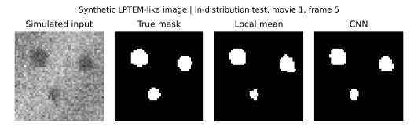

# 第7章案例｜模拟 LPTEM 颗粒分割

给定一段带噪图像，逐帧估计颗粒前景及其总面积。案例输入由代码生成，全部属于**模拟数据**。生成器在 48 × 48 像素网格上画三颗缓慢平移、半径递增的圆形颗粒，以软边缘、空间变化的背景及独立高斯噪声构造强度图。真值为三个硬边缘圆的并集。每段包含 8 帧。生成器省略了液层厚度变化、像差、电子计数过程、束流诱导反应与粒子重叠，不能据此评价真实实验性能或判断生长机制。

## 比较与评价

- **局部均值法**对 5 × 5 邻域求均值，再对暗度分数设阈值。两种方法都对边界采用反射填充。
- **CNN**在每个像素共享八个 5 × 5 卷积核（实现使用互相关），接 ReLU 和一个 1 × 1 卷积产生前景分数。按卷积窗口展开矩阵后，可直接用 NumPy 查看梯度计算。使用加权二元交叉熵、固定学习率 0.1 和 20 轮小批量梯度下降。前景权重为训练背景像素数除以训练前景像素数。
- 训练 16 段、验证 4 段、同分布测试 8 段、偏移测试 8 段。各组使用独立随机数流并按整段划分。两种方法分别在各自验证分数范围内扫描 81 个阈值，选择验证集段均 IoU 最高者。偏移测试对比度参数由 0.28 降到 0.14，噪声标准差由 0.09 升到 0.17，两项同时变化。
- 每段先把全部帧的前景像素计数合并，再计算 IoU（交集除以并集）和 Dice（两倍交集除以预测与真值前景面积之和），最后对各段等权平均。面积 MAE 为逐帧预测与真值前景面积的绝对误差先在段内、再在段间取平均，单位为像素平方。面积误差可能因误分和漏分抵消而较低，应结合空间重叠指标判断。

## 运行

在仓库根目录执行。验证环境为 Windows、Python 3.12.14、NumPy 2.5.4、Matplotlib 3.11.2。仅计算指标时只依赖 NumPy，使用 `--plot` 时需要 Matplotlib。

```bash
python -m pip install numpy matplotlib
python code/ch07_exercises/lptem.py --seed 2026 --out lptem_results --plot
```

输出 `training.csv`（每轮训练加权损失）、`metrics.csv`（逐段指标及验证选出的阈值），以及可选的同一图的 SVG、PDF、PNG。输出目录自行指定。若 CPU 使用 OpenBLAS，可在运行前设环境变量 `OPENBLAS_NUM_THREADS=1` 来减少小矩阵运算的线程开销。

## 已运行的结果

在上述环境中，以 2026 为种子运行两次。两次的 `metrics.csv` 和 `training.csv` 分别逐字节一致。训练加权损失从第 1 轮 0.5754 降到第 20 轮 0.1914。

| 测试条件 | 方法 | 平均 IoU | 平均 Dice | 面积 MAE（像素平方） |
| --- | --- | ---: | ---: | ---: |
| 同分布 | 局部均值 | 0.636 | 0.772 | 26.6 |
| 同分布 | CNN | 0.673 | 0.801 | 25.7 |
| 偏移 | 局部均值 | 0.265 | 0.400 | 69.2 |
| 偏移 | CNN | 0.255 | 0.389 | 68.6 |

偏移条件下，两种方法的 IoU 都下降，局部均值法的 IoU 略高，CNN 的面积 MAE 略低。每个条件仅有 8 段，表中数值来自一次随机种子。强度对比和噪声同时变化，若要区分二者的影响，可分别改变其中一个模拟参数，保持颗粒轨迹和其他条件相同。



示例图预先固定为同分布测试第 1 段第 5 帧。白色为前景。原图采用固定灰阶显示范围，掩膜使用相同黑白映射，均采用最近邻显示。该帧展示分割误差的空间分布，整体表现应以逐段指标表为依据。使用真实序列时，可先按独立实验或芯片划分数据，再估计标注差异、粒子重叠和分布偏移对性能的影响。

## 已归档的数值记录

默认运行的32条逐视频指标与20轮训练损失见[年度第7章结果归档](https://github.com/Yuxinsitu/intelligent-analytical-chemistry/tree/g07-ch07-lptem/resources/annual/2026-2027/results/ch07)，附运行命令、依赖版本与校验和。在仓库根目录运行：

```bash
python code/ch07_exercises/verify_results.py
```

该入口从逐视频记录重新计算两种条件、两种方法的平均 IoU、Dice 和面积 MAE，并与归档汇总及本文舍入值核对；缺失视频、重复记录或汇总冲突会报错。它核验已有数值记录的完整性与汇总计算，不从原始帧重新执行分割，也不替代真实 LPTEM 数据验证。
