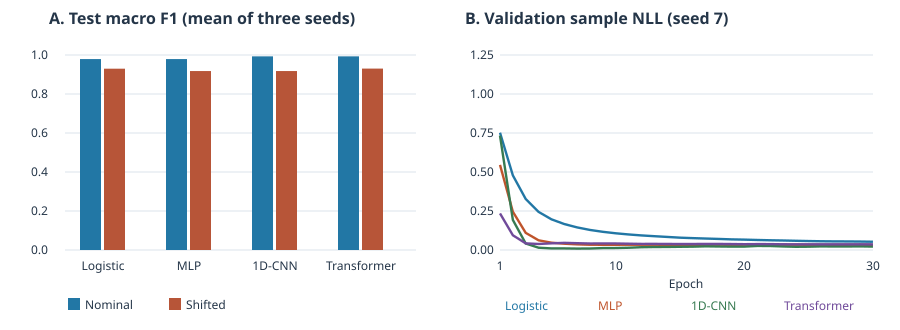

# 模拟光谱分类实验

在仓库根目录运行。已验证环境为 Windows、Python 3.12、NumPy 2.3.5、PyTorch 2.15.0+cpu。

```bash
python -m pip install numpy==2.3.5
python -m pip install torch==2.15.0 --index-url https://download.pytorch.org/whl/cpu
python code/ch07_exercises/gradient_check.py
python code/ch07.py --out runs/ch07-spectra
```

## 数据与协议

脚本生成三类双高斯峰，采用 64 点无量纲轴，改变峰位、峰宽、振幅、基线和扫描噪声。每批 24 个样品，每个样品两次模拟扫描，标签由生成器指定。数据种子 2026，模型种子 7、19、42。批次 0–5 训练，6–7 验证，8–11 测试，其中 10–11 额外增加基线、斜率、轴漂移和噪声。标准化仅用训练扫描的全局均值和标准差。训练采用同一优化器和轮次上限，各模型以验证样品负对数似然最低的轮次进行测试。重复扫描先平均类别概率，再按样品计分。

基线是多项逻辑回归。CNN 以局部卷积找峰形，以分区池化和展开保留峰位。Transformer 将四点组成一个 token，用可学习位置向量和四头自注意力，按原序展开 token 后分类。固定训练协议有助于对照，参数量和归纳偏置仍不同，结果不能单独归因于注意力。

## 实测结果

| 模型 | 参数 | 全测试宏 F1 | 常规批次宏 F1 | 偏移批次宏 F1 |
| --- | ---: | ---: | ---: | ---: |
| 逻辑回归 | 195 | 0.955 | 0.979 | 0.930 |
| MLP | 2179 | 0.948 | 0.979 | 0.918 |
| 1D-CNN | 1819 | 0.955 | 0.993 | 0.918 |
| Transformer | 3331 | 0.962 | 0.993 | 0.930 |

每列对三个模型种子的样品级宏 F1 取均值。常规与偏移各 48 个测试样品。三次种子共享同一数据，种子波动反映初始化与小批量训练差异。偏移批次较难，Transformer 在全测试的均值略高，偏移批次均值与逻辑回归四舍五入后相同。偏移同时修改四类条件，需逐项消融才能识别误差来源。样品均为模拟，结果用于教学。



- `metrics.json` 保存模型参数量、所选轮次、准确率、宏 F1 和混淆矩阵，按全测试、偏移条件及每批分层。
- `history.csv` 保存每轮训练扫描损失和验证样品损失。
- `predictions.csv` 每行对应一个模型、种子和测试样品，含批次号、样品号、标签、预测及三类概率。筛选 `actual != predicted` 可回查失败样品。种子 7 的逻辑回归中，32 个 0 类样品里有两个被分成 1 类、一个被分成 2 类。
- 默认实验重复运行两次，三个输出文件的 SHA-256 分别一致。中央差分最大梯度误差为 `9.906e-12`。

练习可先将模拟器的噪声、基线与峰位漂移分别改成独立对照，再用验证批次选择干预方案。若修改测试模拟条件，应把新的批次和假设作为另一次实验记录。
