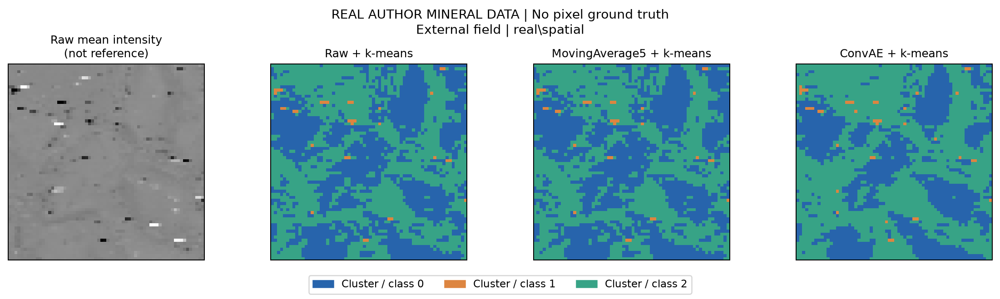
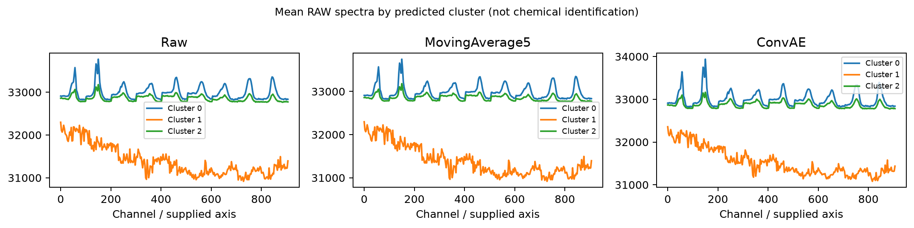
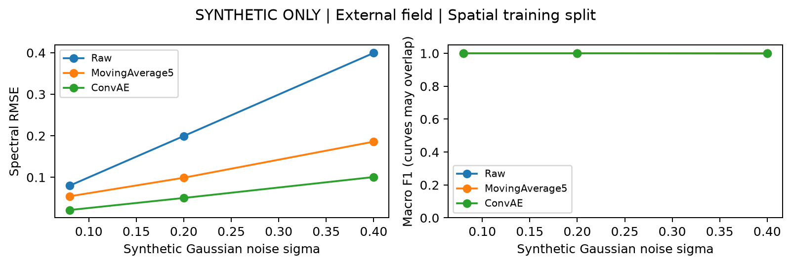

# 成员 B 实验结果与交接报告

## 完成范围

已实际下载作者 FOV1/FOV2 原始矿物 TIFF，完成简化卷积自编码器、传统移动平均、潜在特征/光谱 k-means、真实组分类别图、模拟真值评价、划分审计及交互图查看器。

**这是 UHRED 思路的教学简化与扩展，不是论文精确复现。真实图中 Cluster 不代表已确认矿物，更不代表浓度。模拟数据不属于作者实验数据。**

## 真实数据与方法

- data/raw/fov1.tif：原始形状 `[909, 256, 256]`，抽样后 `[64, 64, 303]`；SHA256 `981f21424e78425b4670efe239db7047594e66f9dc7012f4b484e8ece93c2341`。
- data/raw/fov2.tif：原始形状 `[909, 256, 256]`，抽样后 `[64, 64, 303]`；SHA256 `89523deb17fb647f95055f7f6694d11ae10be56a47bbc4436c53e14d6726cf64`。

空间步长4、光谱步长3；通道索引保持来源。使用训练像素的全局均值和极差归一化，三种方法统一使用相同划分。自编码器2层1D卷积、6维潜在空间，MSE带噪自重建，Adam学习率0.002，weight decay 1e-5，80轮，batch上限128，按验证带噪MSE保存模型。没有用干净真值早停。

原始数据/5通道移动平均接光谱k-means；ConvAE接潜在特征k-means，K=3。K是教学指定值，不是自动推断出矿物种类。图中颜色用训练像素重叠对齐，外部测试标签不用于显示对齐。

真实数据没有逐像素类别和干净参考，所以不能报告识别准确率、真实去噪RMSE或PSNR。`error_maps` 在真实数据下仅表示相对原始输入的变化；变化少不等于效果好。极端信号未做论文的人工饱和像素替换，可能主导某些聚类。

## 有真值模拟实验：外部视野，空间划分训练

模拟数据由解析峰和几何空间区域生成，每个视野48×48×96；三类纯组分，存在光强变化与轻微视野级谱峰变化，不代表真实矿物，也未模拟混合丰度。噪声是人工独立高斯噪声，不等同于完整SRS噪声机制。

| 噪声σ | 方法 | RMSE↓ | PSNR/dB↑ | SAM/度↓ | 宏F1↑ |
|---|---|---|---|---|---|
| 0.08 | Raw | 0.0800 | 24.42 | 19.43 | 1.0000 |
| 0.08 | MovingAverage5 | 0.0542 | 27.80 | 13.24 | 1.0000 |
| 0.08 | ConvAE | 0.0212 | 35.97 | 4.71 | 1.0000 |
| 0.2 | Raw | 0.1994 | 16.49 | 40.90 | 1.0000 |
| 0.2 | MovingAverage5 | 0.0989 | 22.58 | 24.61 | 1.0000 |
| 0.2 | ConvAE | 0.0502 | 28.47 | 11.04 | 1.0000 |
| 0.4 | Raw | 0.3995 | 10.45 | 59.89 | 0.9993 |
| 0.4 | MovingAverage5 | 0.1859 | 17.10 | 41.21 | 0.9993 |
| 0.4 | ConvAE | 0.1006 | 22.43 | 21.95 | 0.9993 |

逐噪声判断（基于本次固定种子，非统计显著性结论）：

- σ=0.08：RMSE最低为 ConvAE（0.0212）；宏F1最高为 Raw、MovingAverage5、ConvAE（1.0000，多个方法时为并列）。不能预设深度学习在所有指标上获胜。
- σ=0.2：RMSE最低为 ConvAE（0.0502）；宏F1最高为 Raw、MovingAverage5、ConvAE（1.0000，多个方法时为并列）。不能预设深度学习在所有指标上获胜。
- σ=0.4：RMSE最低为 ConvAE（0.1006）；宏F1最高为 Raw、MovingAverage5、ConvAE（0.9993，多个方法时为并列）。不能预设深度学习在所有指标上获胜。

## 划分与相邻像素审计

| 数据 | 划分 | 训练/验证/测试数量 | 测试像素直接邻接训练比例 |
|---|---|---|---|
| 真实 | random | 2662/614/820 | 98.171% |
| 真实 | spatial | 2240/768/832 | 0.000% |
| 模拟σ=0.20 | random | 1497/346/461 | 98.265% |
| 模拟σ=0.20 | spatial | 1248/432/432 | 0.000% |

训练与测试索引无交集；空间划分在训练/验证及验证/测试之间留两列缓冲。邻接比例只检查上下左右直接相邻，不代表消除了所有空间相关。FOV2完全不参与拟合，但仍不能证明跨样品/批次/仪器泛化。

随机和空间划分的训练量及组成不同，指标差异不能全部归因为泄露。若本次随机划分没有更高分，也不能据此认定它没有风险。这里展示风险与审计，而非预先保证某种分数趋势。

## 错误分析与化学信息边界

- 对照 `error_maps` 与 `spectra` 判断误差是否集中在某类光谱和较高信号区域。模拟图为真实误差，真实矿物图仅为改变量。
- 移动平均可能削弱窄峰；瓶颈网络可能改变峰高、抑制弱峰。请结合SAM与峰高误差，不只看图像平滑度。
- 分类图每个像素只有一个类别，没有丰度估计；混合组分不能通过单标签图正确表达。
- 当前合成样品较简单，结果不能作为真实矿物准确性的替代证据。
- 当前固定种子725单次运行，未进行多次统计或调参选择最优测试结果。

## 复现、交接与未完成的外部环节

完整命令见 README_B.md；依赖版本和耗时见各 run_manifest.json。PNG用于汇报，SVG用于编辑，NPZ/CSV用于复核；查看器可本地切换结果。

本机已执行训练与输出验证；尚未由其他同学在独立环境完成交叉验证。材料在独立分支整理，远程提交状态见对应PR。年度目录按Issue暂定2026-2027，合并前由C核对仓库命名。汇报最终PDF由C整合，本文提供B部分讲稿。2021论文是否满足“近年”需由A确认并补充。

## 来源

Abdolghader et al. Optics Express 29(21),34205–34219 (2021). DOI: https://doi.org/10.1364/OE.439662 。
作者代码：https://github.com/CLEANit/SRS2021 。作者数据：https://clean.energyscience.ca/datasets/ 。课程任务：https://github.com/Oaham725/intelligent-analytical-chemistry/issues/9 。

### 高噪声逐类别错误（模拟外部视野）

- Raw：类别0/1/2错误率分别为 0.06%、0.00%、0.00%。
- MovingAverage5：类别0/1/2错误率分别为 0.06%、0.00%、0.00%。
- ConvAE：类别0/1/2错误率分别为 0.06%、0.00%、0.00%。

空间训练区类别0/1/2像素数：[773, 288, 187]。三类均进入训练，但仍存在类别比例差异。两个模拟视野共享几何布局，光谱与噪声实现不同；不代表跨结构样品的泛化。每个噪声水平分别重新训练模型，因此曲线也不是同一固定模型的抗噪测试。
