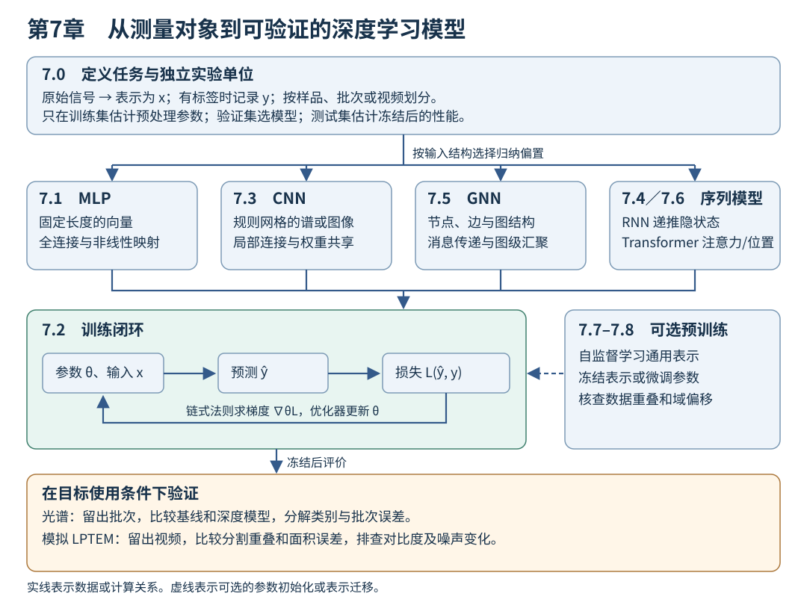
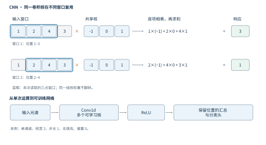
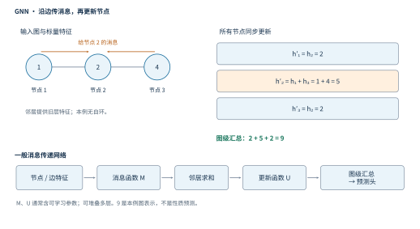
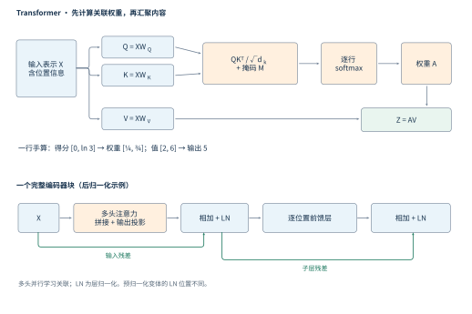
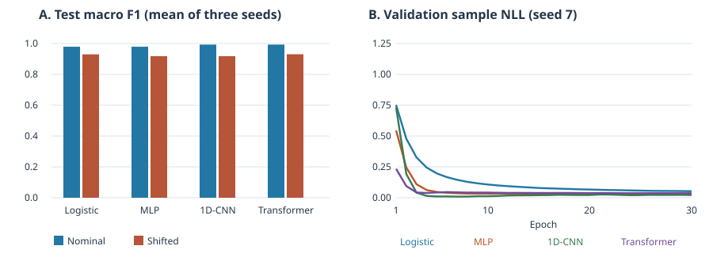
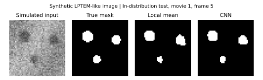

# 第7章 神经网络、Transformer、GNN与基础模型

> 第2篇 化学数据的模型、表示与生成

## 章首导引

同一种物质的光谱会随仪器、基线和样品制备条件改变。一个分类器究竟利用了峰形、峰间关系，还是恰好与类别重合的采集批次？本章从测量对象、表示和验证边界出发，说明怎样根据谱图、图像、序列或分子图的结构选择网络，并以同一组模拟光谱比较逻辑回归、MLP、1D-CNN 和 Transformer。原位液相透射电子显微镜（LPTEM）案例把相同的验证原则应用到图像序列。

完成本章后，应能核对张量形状、推导两层网络的梯度、解释不同网络的归纳偏置，以及设计按样品或实验分组的验证和失效分析。

## 本章知识图谱



## 7.0 从化学测量到学习任务

### 一个样品可以产生几条数据

设实验室要根据红外光谱判断一份样品是否含有组分 A。每份样品扫描两次，每条光谱记录 64 个波数处的强度，类别由独立参照方法确定。50 份样品可产生 100 条光谱，但从“下一份样品能否判对”这个问题来看，独立样品仍只有 50 份。建模前先写清三件事：模型实际接收什么，正确答案从哪里来，下一次预测面对的是哪一种新对象。

用 $x=(x_1,\ldots,x_L)^\top\in\mathbb R^L$ 表示一条光谱， $x_j$ 是波数 $\nu_j$ 处的强度。把 $B$ 条光谱作为行排列，得到矩阵 $X\in\mathbb R^{B\times L}$。一维卷积一般另设通道维，输入形状为 $B\times C\times L$。图像把采样轴换成行和列，得到 $B\times C\times H\times W$。若每个样本是视频，还需区分时间轴和空间轴。这些多轴数组称为**张量**。两个数组尺寸相同，波数方向、像素尺度或帧间隔仍可能不同。因此应保存物理坐标、单位、采集条件和样品标识，并在变换前检查这些信息。

以下是四条虚构扫描。两个波数分别记为 $\nu_1$ 和 $\nu_2$，阳性为 1。

| 样品 | 扫描 | $x_1$ | $x_2$ | $y$ |
| --- | --- | ---: | ---: | ---: |
| S01 | 第一次 | 3.0 | 2.0 | 1 |
| S01 | 第二次 | 3.1 | 2.1 | 1 |
| S02 | 第一次 | 2.4 | 2.2 | 0 |
| S02 | 第二次 | 2.3 | 2.2 | 0 |

规则“ $x_1>2.7$”与规则“ $x_1-x_2>0.5$”都能判对表中的四条扫描。若 S02 两次扫描都叠加了 0.5 的共同背景，第一条规则将误报，第二条规则的判断保持不变。两者在已见样本上同样准确，对未来数据却有不同的假设。用这个差别来理解模型的**归纳偏置**：选择何种表示和规则，实际上是在选择哪些变化值得依赖、哪些变化可以忽略。

### 从两处强度构造一个特征

暂时只取两处波数。设某条光谱的强度向量为 $x=(3,2)^\top$，第一点含候选峰，第二点用于参照背景。若两点都叠加了同一个基线偏移 $c$，则 $(3+c)-(2+c)=1$。用矩阵同时计算两点的差和均值，可写为

$$
W=\begin{pmatrix}1&-1\\ 1/2&1/2\end{pmatrix},
\qquad Wx=\begin{pmatrix}1\\2.5\end{pmatrix}.
$$

$W$ 的每一行定义一种加权组合。差值对共同偏移不敏感，均值仍会随之变化。若背景有斜率，或两个点都含组分 A 的吸收，差值可能损失有用信号。这个例子说明，**特征表示决定模型能看到哪些差异**。由人工指定 $W$ 可以编码测量知识，由数据学习 $W$ 则可以构造任务相关特征。再加上偏置向量 $b$ 得到仿射变换 $Wx+b$。当批量样本按行排列时，应写成 $XW^\top+b^\top$，偏置加到每一行。

### 从测量波动到学习目标

用 $Y$ 表示参照标签或参考值， $X$ 表示随机取得的测量信号。分类模型估计 $P(Y=k\mid X=x)$。回归模型可以将参考值表示为 $Y=f(X)+\epsilon$，其中 $\epsilon$ 为给定信号后仍存在的随机残差。若误差独立、均值为零且服从同方差高斯分布，固定方差下的负对数似然与残差平方和只差常数和正比例因子，因此可用均方误差拟合。若高浓度样品的误差波动更大，可以利用独立重复估计不同浓度区间的方差，再检验加权拟合是否改善目标区间的误差。

假设对同一稳定样品做三次独立重复测量，得到 9、10、11 个测量单位。样本均值为 10，按分母 $n-1$ 计算的样本方差为 1，均值的估计标准误为 $1/\sqrt 3$。若三个结果共享未校正的仪器漂移，这个标准误会漏掉共同误差。要估计新样品间的变化，需要独立样品层面的数据，且要区分样品间差异与同一样品的重复性。

目标的来源也决定学习方式。用已知类别或浓度拟合预测器属于**监督学习**。仅用光谱聚类来探索可能的样品群属于**无监督学习**。掩去一段光谱，再用其余部分预测被遮挡强度，监督信号来自测量本身，属于**自监督学习**。聚类结果需要参照实验才可指认化学类别，掩码预测的误差也要经过下游评价才有助于判断是否学到了可迁移的表示。

### 怎样知道模型学会了

假设把两条重复光谱随机拆开，恰好一条进训练集，一条进测试集。两条光谱可能共享样品特有的峰位与背景。预测正确时，无法单凭这个结果推断模型能否认出另一份样品。若问题是预测新样品，应让同一样品的所有扫描和增强副本进入同一分区。若问题是部署到新仪器，则应留出整台仪器或完整测量批次。视频案例同理，应按实验、芯片或整段视频划分，具体取决于未来遇到的新对象。

先划分，再拟合预处理。训练集估计插补值、标准化参数、PCA 方向与网络权重。验证集用于选择模型、阈值和停止轮次。测试集在流程固定后使用。若要用分组交叉验证估计模型选择流程的性能，外层留组负责评价，内层只用外层训练组调参。整个数据集上的标准化、相邻帧跨集和反复据测试结果改模型都可能泄漏信息。

训练集上的平均损失称为经验风险，目标分布上的期望损失是泛化风险。即便没有泄漏，换仪器也可能移动峰位，换样品基质还可能改变谱形和标签之间的关系。学习曲线可以帮助排查过拟合，独立批次则用来测量条件改变时的性能。报告结果时应同时交代测试对象、最差组和真实部署条件。课后可比较按扫描和按样品划分的结果，先判断两种实验分别回答什么问题，再解释分数的变化。

## 7.1 感知机、非线性表示与多层网络

### 一条直线可以分开什么

沿用两处强度的例子。若参照点已校准，可用 $w=(1,-1)^\top$ 和 $b=-0.5$ 计算 $z=w^\top x+b$。当 $z\geq0$ 时预测存在组分 A。用阶跃函数实现这一判别就得到一个感知机。其分界线为 $x_1-x_2=0.5$。改变 $w$ 的方向会改变分界线的朝向。在 $w$ 固定且非零时，改变 $b$ 会平移分界线。现代分类常以逻辑回归作为这一类线性决策边界的概率基线，二分类时以 sigmoid 将 $z$ 变为概率。

再考虑一个人为构造的判别任务。两处响应都被编码为 0 或 1，恰有一处响应为 1 时判为正类。两种正例位于正方形一条对角线上，两种负例位于另一条对角线上。两条对角线交于同一点，任何直线都无法把这两组顶点完全分开。这是 XOR 问题。它表明，有些判别规则需要组合多种局部响应。

### 两个隐藏单元怎样组合响应

定义 $\mathrm{ReLU}(u)=\max(0,u)$。令第一个隐藏单元计算 $h_1=\mathrm{ReLU}(x_1-x_2)$，第二个计算 $h_2=\mathrm{ReLU}(x_2-x_1)$。两者相加为 $|x_1-x_2|$。用 $h_1+h_2>0.5$ 判别，四个输入即可正确分开。各单元只对一种差值方向响应，输出层把两个方向组合成“有差异”的判断。若把两处强度替换成真实峰面积，能否采用同样判据取决于化学响应和仪器噪声。这里的权重是手工构造的，用于说明隐藏层怎样改变可表达的决策边界。

把四种输入逐项代入，可以看清两个隐藏单元的分工。表中的数值都是由上述公式计算的教学例子。

| 输入 $(x_1,x_2)$ | 第一单元 $h_1$ | 第二单元 $h_2$ | 汇总 $h_1+h_2$ | 是否大于 0.5 | 预测类别 |
| --- | ---: | ---: | ---: | --- | ---: |
| (0, 0) | 0 | 0 | 0 | 否 | 0 |
| (0, 1) | 0 | 1 | 1 | 是 | 1 |
| (1, 0) | 1 | 0 | 1 | 是 | 1 |
| (1, 1) | 0 | 0 | 0 | 否 | 0 |

例如，输入为 (0, 1) 时，第一个差值是 −1，经过 ReLU 后变为 0；第二个差值是 1，经过 ReLU 后保持为 1。ReLU 的作用是把负响应截为零、保留正响应。它并不表示概率，输出也不限制在 0 到 1 之间。这里恰好只有 0 和 1，是所选输入与权重共同造成的。

从几何上看，第一个单元在 $x_1>x_2$ 一侧产生正响应，第二个单元在相反的一侧产生正响应。在隐藏表示空间中，两种负例都映射到原点，两种正例分别映射到 (1, 0) 和 (0, 1)，于是用一条直线 $h_1+h_2=0.5$ 就能分开。若把输入扩展为连续数值，映射回原输入平面后的正类区域是 $x_1-x_2>0.5$ 或 $x_2-x_1>0.5$，即两条平行线之间带状区域的外侧。输出层在隐藏空间中采用线性判别，整个网络在原输入空间中却已形成非线性决策规则。

下面用批量矩阵运算复核表格。`X` 的每行是一个输入，`W1` 的每行是一组隐藏单元权重，因此使用 `X @ W1.T`。偏置在本例中为零，省略不写。

```python
import numpy as np

X = np.array([[0, 0], [0, 1], [1, 0], [1, 1]])
W1 = np.array([[1, -1], [-1, 1]])
H = np.maximum(X @ W1.T, 0)
score = H.sum(axis=1)
y_pred = (score > 0.5).astype(int)
print(np.column_stack((X, H, y_pred)))  # 各列依次为 x1、x2、h1、h2、预测类别
```

这段代码只做前向计算，没有训练过程。它说明这组参数能够实现所需规则，不说明优化算法从任意初值都能找到这组参数。思考：若去掉 ReLU，两个差值直接相加会得到什么，原先的四种输入还能分开吗？

### 从手工构造到数据学习

一般地，令输入 $x\in\mathbb R^L$，隐藏层有 $m$ 个单元，分类数为 $K$。两层网络的前向计算为

$$
a=W_1x+b_1,\qquad h=\phi(a),\qquad z=W_2h+b_2.
$$

$W_1$ 和 $W_2$ 的形状分别为 $m\times L$ 与 $K\times m$。 $a$ 是激活前的响应， $\phi$ 逐元素作用， $h$ 是隐藏表示， $z$ 是分类分数，即 logits。若 $\phi$ 为恒等映射，两层就合并成 $W_2W_1x+W_2b_1+b_2$。因此增加仿射层本身仍只产生仿射映射。ReLU 在正半轴传递梯度，负半轴的梯度为零。sigmoid 的两端趋于饱和，多个小导数连乘会使较早层的梯度很小。

实际训练时，先初始化权重与偏置，再根据训练样本计算输出和损失，经反向传播求梯度并更新参数。学习得到的隐藏单元可能组合多个谱段，也可能主要响应背景或仪器差异；不能仅因某个单元被激活，就把它解释为一种化学组分。是否学到了与目标有关的特征，还要结合受控输入扰动和独立批次评价。下一节将把这条“前向计算—损失—梯度—更新”的路径逐步写出来。

ReLU 的零梯度也需要结合输入范围理解。某个单元对当前样本的激活前响应为负时，该样本经这条激活路径传回的梯度为零；换一个样本，响应可能转为正值。如果它对全部训练输入都持续处于负半轴，这条路径就难以通过数据损失获得更新。排查时应检查输入尺度、偏置、初始化和学习率。Leaky ReLU 等变体在负半轴保留小斜率，但是否改善任务仍需验证，不能把更换激活函数当作必然有效的补救。

两层全连接共有 $m(L+1)+K(m+1)$ 个可训练参数。本章光谱 MLP 取 $L=64,m=32,K=3$，代入得 2179，与脚本输出相符。参数更多时可以表示更复杂的函数，能否改善独立批次的表现仍需检验。运行光谱案例时可先追踪一批输入从 $(B,64)$ 到 $(B,32)$ 再到 $(B,3)$，再问隐藏单元数增加后，收益来自哪些类别与哪些批次。

## 7.2 损失函数、反向传播与优化稳定性

### 预测错了多少

设模型对 $K$ 类给出分数 $z$。令 $p_k=\exp(z_k)/\sum_{j=1}^K\exp(z_j)$，则各 $p_k$ 非负且和为 1。若真实类别为 $c$，交叉熵损失为 $\ell=-\log p_c$。真实类别获得的概率越小，损失越大。等价地，用独热向量 $y$ 表示真实类别， $\ell=-\sum_k y_k\log p_k$。实现时把 logits 交给数值稳定的交叉熵函数。若任务是测量浓度，可用平方误差训练，并报告与参考量单位相同的 RMSE 或 MAE，同时按浓度段核对偏差。

### 从输出误差回到第一层

偏导数是在固定其他参数时考察某一个参数的局部变化。把各偏导数排在一起就是梯度。要求某个第一层权重的偏导数，可沿着“权重 → 隐藏响应 → 分类分数 → 损失”的路径使用链式法则。直接代入 softmax 可将损失写成

$$
\ell=-y^\top z+\log\sum_{j=1}^K e^{z_j}.
$$

对 $z_k$ 求导，第一项给出 $-y_k$，第二项给出 $p_k$，因此 $g=\nabla_z\ell=p-y$。对 $z=W_2h+b_2$ 取微分， $dz=(dW_2)h+W_2\,dh+db_2$。代入 $d\ell=g^\top dz$，就能分别读出关于 $W_2$、 $h$ 和 $b_2$ 的导数。再用 $dh=\phi'(a)\odot da$ 和 $da=(dW_1)x+db_1$，得到

$$
\nabla_{W_2}\ell=gh^\top,\qquad \nabla_{b_2}\ell=g,\qquad
\delta=(W_2^\top g)\odot\phi'(a),\qquad
\nabla_{W_1}\ell=\delta x^\top,\qquad \nabla_{b_1}\ell=\delta.
$$

$\odot$ 表示逐元素乘积。 $\delta$ 是损失对激活前向量 $a$ 的梯度。批量均值损失对应样本梯度的平均。ReLU 在 0 处没有唯一导数，程序在该点采用约定的值。

取一个可以手算的样本。令 $x=(1,2)^\top$， $W_1$ 的两行为 $(1,0)$ 与 $(-1,0)$，偏置均为 0， $W_2$ 为二阶单位矩阵， $\phi$ 为 ReLU。前向传播给出 $a=(1,-1)^\top$、 $h=(1,0)^\top$ 和 $z=(1,0)^\top$。若真实标签为第二类，则第一类概率 $q=e/(1+e)\approx0.731$，损失为 $-\log(1-q)\approx1.313$。此时 $g=(q,-q)^\top$，由于第二个隐藏单元处于 ReLU 的负半轴， $\delta=(q,0)^\top$。所以 $W_1$ 第一行的梯度为 $(q,2q)$，第二行是零。以 0.1 为学习率同时更新各参数时，第一行变为约 $(0.927,-0.146)$。第二个隐藏单元没有从该样本收到梯度，换一个输入仍可能激活它。可用配套 NumPy 脚本对另一个小网络作中央差分，核对解析梯度与数值梯度。

### 从梯度到可用的模型

设全部参数为 $\theta$，可微损失为 $J(\theta)$。若 $\eta>0$ 足够小，沿负梯度走一步 $\theta'=\theta-\eta\nabla J(\theta)$，损失的一阶变化为 $-\eta\|\nabla J(\theta)\|^2$。学习率过大时，局部近似可能失效。小批量梯度下降用一组训练样本估计梯度。Adam 维护梯度和梯度平方的滑动平均，并对起始阶段的估计作偏差校正。二者都需要用训练与验证曲线检查更新是否稳定。

若训练损失不断下降而独立验证损失回升，可以保存验证损失最低时的参数，或引入正则化后重新比较。L2 惩罚 $\lambda\|W\|^2$ 倾向收缩权重，L1 惩罚倾向得到稀疏解。训练和验证误差同时偏高时，应先排查输入与标签质量、初始化、归一化和优化是否收敛，再判断模型容量是否不足。若验证组来自另一仪器，还应检查域偏移能否解释误差上升。

训练损失与最终评价回答不同问题。假设 100 个样品中只有 5 个为待检组分阳性，全部预测阴性也有 95% 准确率，但阳性召回为 0。对每个类别计算 $F_1=2TP/(2TP+FP+FN)$，再等权平均，可让稀有类别在宏平均中获得同等权重。若概率要驱动复测，可另用独立数据核对可靠性曲线，检查预测概率与实际发生频率的关系。对误判样品应回看原始信号与采集条件，并比较不同拒识阈值下可作判断的覆盖率和留下样品的误差。

## 7.3 CNN：局部结构、峰形与空间图像

一条光谱的峰位因仪器漂移而移动了两个采样点。若用全连接层识别峰的上升沿，原峰位与新峰位分别由不同权重处理。若在各位置使用同一组权重，模型便可在多处检出相似的局部形状。**卷积神经网络**（CNN）利用这两项约束构造特征，即只读取附近的输入，并在各位置共享权重。

设光谱有 $C$ 个输入通道， $x_{c,i}$ 为第 $c$ 个通道在位置 $i$ 的值。深度学习框架常用互相关实现一维卷积。第 $o$ 个输出通道在位置 $t$ 的响应为

$$
y_{o,t}=b_o+\sum_{c=1}^{C}\sum_{j=0}^{k-1}w_{o,c,j}x_{c,st-p+dj}.
$$

这里 $k$ 是核宽， $s$ 是步长， $p$ 是每侧填充宽度， $d$ 是膨胀率， $w$ 和 $b$ 分别是核权重和偏置。取单通道输入 $(1,2,4,3)$ 和核 $(-1,0,1)$，令 $s=d=1$、 $p=b=0$。第一个窗口的响应是 $-1+4=3$，第二个窗口是 $-2+3=1$。同一核在两处都计算窗口右端与左端之差。用 NumPy 的 `np.correlate([1,2,4,3], [-1,0,1], mode="valid")` 可复核。二维情形则让核同时沿图像的行与列滑动。



**图 7-1　CNN 怎样把局部输入变成特征。** 上半图的蓝框每次向右移动一个位置，框内三个数与同一组核权重逐项相乘后求和，依次得到响应 3 和 1。框外的输入不参与当前响应。这里手动给定核以便核算；实际训练用损失的梯度更新核权重和偏置，一个卷积层通常并行学习多个核，产生多个输出通道。随后通过 ReLU 引入非线性，再由后续层汇总特征、完成任务。二维卷积把一维窗口换成沿行、列滑动的小矩阵；输入有多个通道时，同一输出还需汇总各输入通道的响应。

从代码看，单个样本的滑窗矩阵可以乘以核向量，得到全部位置的响应；批量框架则直接接收形状为 `B × C × L` 的张量。图中下半部分是光谱分类结构示意，分割任务则需要产生各像素的输出。运行[前向运算图例脚本](../code/ch07_exercises/model_steps.py)可核对上半图。思考：如果两个窗口各自学习一套核，还保留了“共享权重”这一约束吗？

有效核宽是 $d(k-1)+1$。从填充后长度 $L+2p$ 中扣去有效核宽，余下距离每隔 $s$ 个位置放置一个窗口。计入第一个窗口，输出长度为 $\lfloor (L+2p-d(k-1)-1)/s\rfloor+1$，前提是填充后至少容纳一个窗口。随着层数增加，一个输出可受更大范围的原始输入影响，这个范围称为**感受野**。两层核宽为 3、步长为 1 的卷积中，第二层读取第一层的三个相邻响应，每个响应又读取原始输入的三点。取这些位置的并集，得到宽度为 5 的感受野。一般地，若 $J_{\ell-1}$ 是上一层相邻输出在原始输入中的间隔，则 $R_\ell=R_{\ell-1}+(k_\ell-1)d_\ell J_{\ell-1}$， $J_\ell=s_\ell J_{\ell-1}$，初始 $R_0=J_0=1$。

共享权重适合重复出现的边缘或峰形，池化可缩短表示。若两类物质的峰形相近、特征峰只在绝对波数上有差异，全局平均池化可能把关键信息一并消去。光谱实验采用分区池化并按原序展开，保留粗略的位置信息。可将同一个峰移到邻近位置与较远位置，比较峰形识别的稳定性以及类别判断是否随物理峰位合理变化。对于显微分割，同样应检查下采样是否抹去小颗粒边界。

## 7.4 RNN：序列、时间与分子字符串

原位视频的某一帧中，颗粒突然变暗。单帧模型只能依据当前像素判断，序列模型还可利用先前几帧的形状和位置。**循环神经网络**（RNN）用隐状态 $h_t$ 表示截至时刻 $t$ 的历史信息，以相同参数递推

$$
h_t=\phi(W_xx_t+W_hh_{t-1}+b).
$$

$x_t$ 可是第 $t$ 帧的面积、质心或图像编码。为看清历史如何传递，令激活为恒等函数，取标量递推 $h_t=x_t+0.5h_{t-1}$， $h_0=0$。当输入依次为 $(4,0,0)$ 时，隐状态依次是 $(4,2,1)$。第三时刻依然保留第一次输入的影响，权重已缩到四分之一。在线性例子里，跨 $k$ 步的导数为 $0.5^k$。非线性网络中的对应项是多个局部雅可比矩阵的乘积，反复相乘可能使梯度衰减或放大。LSTM 和 GRU 用门控控制保留、遗忘和更新，使历史信息有更直接的传递路径。

对于时间序列，两个相邻索引可以相差一秒，也可能因丢帧而相差十秒。处理不规则采样时，应显式给出时间间隔，或说明重采样依据。离线回看完整视频可以同时利用前后帧。实时预警的模型在时刻 $t$ 只能使用已取得的观测。分子字符串也可作为序列输入，但 SMILES 中的字符相邻关系由字符串写法决定。评价时应按分子划分，避免同一分子的多种字符串跨集合。

## 7.5 GNN：图表示、消息传递与图级预测

两份分子文件记录的是同一分子，只是原子编号不同。若把原子属性按编号排成一个长向量，模型可能把编号变化也当作输入变化。以**图** $G=(V,E)$ 表示分子时， $V$ 为原子集合， $E$ 为键集合。原子类型、形式电荷等可写入节点特征，键型可写入边特征。图神经网络（GNN）用连接关系限定信息从哪些邻居传来。

在第 $\ell$ 层，令 $h_v^{(\ell)}$ 为节点 $v$ 的表示， $N(v)$ 为其邻居， $e_{uv}$ 为边特征。先汇总消息，再更新表示：

$$
m_v=\sum_{u\in N(v)}M_\ell(h_v^{(\ell)},h_u^{(\ell)},e_{uv}),\qquad
h_v^{(\ell+1)}=U_\ell(h_v^{(\ell)},m_v).
$$

$M_\ell$ 和 $U_\ell$ 在同一层共享。考虑三节点链，初始特征为 $(1,2,4)$。若消息就是邻居的特征，更新只保留邻居和，则一轮后得到 $(2,5,2)$，图级求和为 $9$。若交换原来的第一个节点和中间节点的编号，邻接关系与节点特征同时置换，输出也按同样的规则重排为 $(5,2,2)$，图级总和仍为 $9$。用邻接矩阵 $A$ 和特征矩阵 $H$ 计算 `A @ H` 可验证这一步。实际任务中可从节点表示预测原子属性，或在对称汇总后从整图表示预测分子性质。总和受节点数与节点特征共同影响，均值可减弱节点数直接带来的尺度变化。若需要准确保留分子大小，可以显式提供节点数。



**图 7-2　GNN 怎样把邻接关系变成计算路径。** 圆内数字是节点特征，灰线是无向边；橙色箭头只突出节点 2 收到的两条消息。它读入节点 1 和节点 3 的旧特征，得到 $1+4=5$。两个端点各只有一个邻居，所以都得到 2。三个更新同时依据旧层特征计算，不能在更新中间节点后立刻把新的 5 传给端点，否则就改变了这层的运算。

在这个无自环、无可学习变换的例子中，邻接矩阵 `A` 的元素 `A[v, u] = 1` 表示节点 `v` 接收节点 `u` 的特征，故一轮更新就是 `H_next = A @ H`。实际 GNN 的消息函数还可以读取键类型，更新函数可以结合本节点的旧表示与邻居消息，并通过训练学习参数。堆叠多层后，图级任务再对所有节点作对称汇总、送入预测头。图中的 9 只是求和得到的图表示，尚不是分子性质。思考：交换节点编号时，只重排 `H` 而不同时重排 `A`，还能表示原来的图吗？[图例脚本](../code/ch07_exercises/model_steps.py)包含正确置换的核对。

一层沿图中的边传播一步，多层才可纳入更远的邻居。图的连接相同但空间构象不同时，二维键图无法凭连接区分它们。可根据性质是否依赖空间排列，引入距离、角度或满足刚体变换要求的模型。若目标是预测未见分子骨架，测试时按骨架分组。仅交换原子编号的检验可以发现排列依赖，不能检验对新骨架的外推。

## 7.6 Transformer：注意力、位置与长程关系

设两类样品在某一谱段都有一个峰，区别在于远处的另一谱段是否出现伴峰。卷积可通过堆叠层逐步扩大感受野，**自注意力**则允许一个谱段直接汇聚其他谱段的信息。汇聚的权重由输入表示决定。若表示包含位置编码，位置也会影响权重。

把 $L$ 个谱段的表示写成 $X\in\mathbb R^{L\times d_m}$。对一个注意力头，令 $Q=XW_Q$、 $K=XW_K$、 $V=XW_V$。查询和键的形状均为 $L\times d_k$，值的形状为 $L\times d_v$。第 $i$ 个查询与第 $j$ 个键的点积表示二者的匹配程度。逐行归一化后得到汇聚权重：

$$
A=\mathrm{softmax}_{\mathrm{row}}(QK^\top/\sqrt{d_k}+M),\qquad Z=AV.
$$

$M$ 在允许读取的位置为零，在屏蔽位置为 $-\infty$。每个查询至少应有一个可读的键。设某行缩放后的得分为 $(0,\log 3)$，softmax 权重就是 $(1/4,3/4)$。若两个值是标量 $2$ 与 $6$，该行输出为 $5$。若屏蔽第二个键，权重变为 $(1,0)$，输出为 $2$。当查询和键的分量近似相互独立、均值为零、方差为一时，点积是 $d_k$ 个单位方差乘积之和，其方差为 $d_k$。除以 $\sqrt{d_k}$ 把分数维持在相近尺度，降低维度增加导致 softmax 饱和的风险。

**多头注意力**为不同头学习各自的投影，拼接各头输出后再做线性变换。Transformer 编码器还包含逐位置前馈层、残差连接与归一化。谱图分类可用编码器读取完整输入，自回归预测则要用因果掩码遮住未来位置。若还需依据另一序列生成结果，例如依据谱段生成峰位说明，可用交叉注意力让解码器提供查询，由编码后的谱段提供键和值。若自注意力既不接收位置编码，也没有位置偏置，且未使用因果等位置相关掩码，对输入行重新排序只会让输出作相同的重排。此后若再对所有行取均值，位置顺序便无法影响结果。固定因果掩码本身依赖顺序，不符合这一前提。有掩码时，重排输入行并同步重排掩码的行与列，可保持上述等变性质。可以加入可学习的位置向量，也可把实际波数、时间或相对距离编码进去。光谱案例保留分块顺序。分块越大，注意力矩阵越小，但过窄的峰可能难以保留。可在独立批次上比较不同分块宽度，并检查窄峰样品的错误率。



**图 7-3　Transformer 怎样按输入内容汇聚信息。** 上半图先把同一份输入表示投影为三组向量。可以把查询 Q 理解为当前位置的检索条件，键 K 为各位置供匹配的表示，值 V 为匹配后要汇入的内容。它们来自可学习的线性投影，不是人工指定的化学标签。`Q @ K.T` 对每个查询计算与各键的匹配分数，缩放并加上掩码后，沿键这一维做 softmax，使每行权重之和为 1；最后用 `A @ V` 计算各查询的输出。图中一行的 $\tfrac14\times2+\tfrac34\times6=5$ 可逐项核对。

下半图把单头运算放回一个编码器块：多头各自并行计算注意力，拼接后通过输出投影恢复输入宽度，才能与输入作残差相加。随后是层归一化（LN）、逐位置前馈层和第二条残差路径。前馈层通常由两个线性层及中间的非线性激活组成，在各位置共享参数。图示采用后归一化，省略 dropout；预归一化会把 LN 放在子层之前。位置编码在进入这些块之前提供位置信息，堆叠编码器块后还需根据分类、回归等任务连接输出头。注意力只是其中一个子层。

[图例脚本](../code/ch07_exercises/model_steps.py)演示单个查询的前向计算，并将第二个键屏蔽后重新计算。思考：为什么掩码应在 softmax 之前加入得分，而不能在得到输出 5 后简单减去第二个值 6？

### 把注意力接成光谱分类器

理解单次加权求和后，还要追问：一条光谱怎样进入网络，网络又怎样学会分类？原始 Transformer 面向序列到序列任务，由编码器和解码器组成。编码器整理输入信息，解码器依据已有输出逐步生成后续内容。分类任务可以在编码器后直接连接分类头。本章光谱案例采用这一结构，流程可对照[原论文第 3 节](https://arxiv.org/html/1706.03762v7#S3)理解；下面的尺寸与分块方式是本章的教学设置。

| 运算步骤 | 单条扫描的形状 | 这一步做什么 |
| --- | --- | --- |
| 读入 64 个波数处的强度 | 64 个数 | 使用仅由训练集拟合的标准化参数 |
| 每 4 个连续强度组成一个 token | 16 × 4 | 得到 16 个有序谱段；token 是谱段，不是独立样品 |
| 线性嵌入并加位置向量 | 16 × 16 | 每个谱段映射为 16 维表示，加入它在整条光谱中的位置 |
| 四头自注意力 | 每头 Q、K、V 均为 16 × 4 | 每头得到 16 × 16 的权重矩阵，再汇聚值向量 |
| 拼接、投影与编码器其余运算 | 16 × 16 | 注意力输出恢复 16 维；残差、层归一化与 16 → 32 → 16 的逐位置前馈层保持该形状 |
| 保持顺序展平并接分类头 | 256 → 3 | 为三个类别各输出一个 logit，再用 softmax 得到概率 |

加入批量轴后，16 × 16 的中间表示成为 $B\times16\times16$。批量轴上的不同扫描各自计算注意力，模型不会在这里把不同样品混成一条序列。每个头的 16 × 16 矩阵表示同一条扫描内谱段之间的读取权重，也不是样品之间的相关系数矩阵。实际代码采用展平读出，因此保留了谱段次序；它不同于前文用来说明排列性质的均值读出。

图 7-3 中的权重是为手算给定的。训练时，损失从分类头传回前馈层、注意力和嵌入层。由于 $A$ 由 $Q$ 与 $K$ 决定，梯度会更新匹配所用的投影；由于 $Z=AV$，值投影也会参与更新。位置向量在本例中同样可学习。各头可以学到不同的匹配方式，但没有规定某个头必须对应某种官能团，训练也不保证各头一定形成清晰分工。

分类器读取已经采集完整的光谱时可使用全部谱段；若改成预测下一时刻的电镜状态，就应按预测时实际可获得的信息设置掩码。训练时用因果掩码可以同时计算多个已知前缀的下一步损失，自回归生成时仍要逐步得到新输出。思考：把光谱随机打乱后再重新训练，与只在测试时打乱波数次序，分别改变了什么条件？

### 阅读结构图时还需分清什么

**自注意力与交叉注意力的输入来源。** 自注意力的 Q、K、V 来自同一序列的当前表示。原始解码器的交叉注意力则在同一块内，先经过带因果掩码的自注意力及其残差、归一化，再用得到的解码表示构造 Q；K、V 来自编码器的最终输出。因此，交叉注意力不能直接当作另一次自注意力。在输入序列已完整可用的任务中，它通常不需要遮住源序列的“未来”，但仍应屏蔽为对齐长度而补入的空位置。原论文的六层、八头是具体配置，不是 Transformer 的定义。

**残差相加与层归一化的职责。** 残差连接保留子层的输入通路，要求相加的张量形状相同。本例的层归一化在每个谱段自己的 16 个特征上计算统计量，不跨扫描或谱段计算。对该位置的特征向量 $u$，其第 $j$ 个分量变为

$$
\mathrm{LN}(u)_j=\gamma_j\frac{u_j-\mu}{\sqrt{\sigma^2+\epsilon}}+\beta_j,\qquad
\mu=\frac{1}{d_m}\sum_{j=1}^{d_m}u_j,\qquad
\sigma^2=\frac{1}{d_m}\sum_{j=1}^{d_m}(u_j-\mu)^2.
$$

其中 $\epsilon>0$ 用于数值稳定， $\gamma_j$ 和 $\beta_j$ 是各特征的可学习缩放与偏置。因此，最终输出并不必然保持零均值和单位方差。层归一化与输入光谱的训练集标准化发生在不同位置，不能互相替代。[层归一化原论文](https://arxiv.org/abs/1607.06450)介绍了逐样本计算统计量的动机。

**训练时已知的目标与生成时可用的输入。** 例如，训练目标是依次生成 a、b 和结束符时，可把起始符、a、b 同时送入解码器，并将监督目标错开一位。因果掩码保证每个位置只读取当前及之前的输入，不会直接读到自己要预测的目标。生成时只提供起始符，随后把已生成的符号继续送入；真实的后续答案并不可用。带真实前缀的条件预测损失与自由生成序列的质量是不同评价，报告时应分开。

固定正弦、余弦位置编码能为训练长度之外的位置计算数值，但这不保证模型能正确外推到更长序列。本例采用长度固定的可学习位置向量，配合固定长度分类头，只处理规定的 64 点输入；换用不同波数网格或更长序列时，需要同时调整输入表示、位置定义与评价设计。延伸导读与上述概念的核对记录见[本章文献证据库](#/resources/annual/2026-2027/references/ch07-g07)。

## 7.7 自监督、迁移学习与小样本适配

假设已有大量无标签光谱，只有少数样品测过参考浓度。可以先遮去一段光谱，让模型用其余信号重建缺失区间。这样，每条原始谱图都同时提供输入与训练目标，这种方式称为**自监督学习**。若遮住的只是一个点，相邻强度的插值就可能获得低误差。若遮住整个峰，需要利用的谱段关系会改变。因此，应把遮盖宽度与仪器采样间隔及目标峰宽联系起来，并用独立样品上的浓度预测检查预训练是否有用。

另一类做法是**对比学习**。例如，把同一标准样品的两次扫描作为匹配对，把不同样品作为候选负对。这样设计有助于减弱扫描噪声的影响，但不同样品可能来自同一物质。若不加区分地把它们推远，表示会削弱所需的类别一致性。对浓度任务也应慎用强度缩放。如果强度是定量依据，强行要求模型忽略缩放就可能丢失目标信息。

有了预训练参数后，可冻结骨干、只训练任务头，也可以微调部分或全部骨干。Adapter 通过新增小模块调整表示。LoRA 将原矩阵固定，只学习低秩更新 $\Delta W=BA$。例如 $W$ 为 $64\times64$，取秩上限 $r=4$，两个因子分别为 $64\times4$ 与 $4\times64$，这个矩阵的更新参数为 $512$ 个，全部微调该矩阵则有 $4096$ 个参数。参数减少可以降低存储适配权重的成本，实际精度与运行时间仍取决于任务与实现。比较适配方案时，可在相同标注量与目标域划分下并列训练简单基线、随机初始化模型和预训练模型，观察迁移究竟减少了哪些误差。若仪器差异主要来自响应尺度和局部基线，也应考虑用独立传递标准样品拟合校准映射，并用另留的目标仪器样品检验残余偏差。

## 7.8 化学基础模型的能力、成本和边界

一个在广泛数据上预训练、并能经适配支持多种下游任务的模型，通常称为**基础模型**。例如，分子骨干可配上性质回归头，显微图像骨干可配上分割头。同一模型能用于多个任务，并不意味着它能直接处理任何样品或成像条件。选择时需要同时了解预训练数据覆盖、标注和算力成本、许可证以及目标任务的评估边界。

以原位液相电镜为例，模型在某一留出视频中得到一串颗粒掩膜。可以根据掩膜和像素标定估计投影面积。若每边像素间距为 $0.5\,\mathrm{nm}$，某个掩膜含 100 个像素，则它的估计投影面积为 $25\,\mathrm{nm}^2$。若下一帧只分割出 80 个像素，估计面积会降至 $20\,\mathrm{nm}^2$。下一步应先问原始图像中的边界是否也变了。对比度下降、液层变化、漂移或阈值都可能改变像素计数。独立标注可核对模型是否稳定识别了同一条边界。若要区分真实尺寸变化、出平面运动或反应过程，还需结合成像条件、对照实验和互补测量。真实视频的相关证据与可核对来源见本章文献证据库。

解释模型时，可遮挡谱段、交换背景或降低图像对比度，比较输出对受控扰动的响应。显著性图和注意力权重可用于定位需要复核的输入区域。预测的可靠性还涉及测量噪声和训练数据覆盖不足。重复采集可帮助估计前者，模型集成的分歧可提示后者，但两者需要在目标域实测。若部署时允许拒识，先用验证集确定质量阈值，再在留出样品上同时报告覆盖率与未拒识样品的错误率。评估新分子或新视频时，还要排查预训练数据与测试数据的重复，尤其是同一分子的不同编码和同一视频的裁剪片段。

## 按数据结构选择模型

| 输入 | 首选对照 | 结构假设 | 优先检查 |
| --- | --- | --- | --- |
| 固定波数网格上的光谱 | 逻辑回归、MLP | 每个波数可有独立作用 | 波数对齐、样品独立和批次背景 |
| 谱图、二维显微图像 | 1D-CNN、2D-CNN | 局部峰形或边缘可在不同位置复用 | 感受野、绝对位置与边界误差 |
| 时间、光谱分块或分子字符串 | RNN、Transformer | 序列位置和远近关系携带信息 | 位置编码、在线掩码和计算成本 |
| 原子与键或接触关系 | GNN | 邻接关系可定义信息传播路径 | 图构造、三维信息与新骨架外推 |

基础模型提供可适配的初始化。是否采用取决于预训练覆盖、任务收益和独立验证结果。方法的发展背景及其化学实例见[文献证据库](#/resources/annual/2026-2027/references/ch07-g07)。

## 代码实践与综合案例

三个基础图例仅依赖 NumPy，输入为固定手算数值，无需随机种子。在仓库根目录运行 `python code/ch07_exercises/model_steps.py`；脚本会打印各步结果并核对数值、GNN 重编号及注意力掩码，不进行模型训练。

- [核对 CNN、GNN 与注意力图例中的前向运算](../code/ch07_exercises/model_steps.py)
- [用中央差分核对反向传播梯度](../code/ch07_exercises/gradient_check.py)

- [同一批模拟光谱比较逻辑回归、MLP、1D-CNN 和 Transformer](../code/ch07.py)
- [模拟 LPTEM 图像序列分析](#/code/ch07_exercises/lptem)
- [光谱实验说明与运行结果](#/code/ch07_exercises/spectra)

### 从学习曲线读到分布偏移



**图 7-4　模拟光谱中的模型比较。** 左图比较常规（nominal）与偏移（shifted）测试批次的样品级宏 F1，柱高为三个训练种子的均值；右图展示种子 7 的验证集负对数似然（NLL）随训练轮次的变化，越低表示给真实类别的预测概率总体越高。验证损失用于选择训练轮次，测试宏 F1 用于评价留出样品，二者回答的问题不同。

读图时先在同一模型内比较两种测试条件，再比较模型之间的差异。各模型在偏移批次上的宏 F1 都下降，说明常规批次的高分不足以保证跨条件泛化。三个种子共用一套模拟数据，不能把种子均值当作跨实验室重复验证。可结合第 7.2 节思考：若只展示训练损失下降，会遗漏图中的哪一种风险？完整参数、划分与指标见[光谱实验说明](#/code/ch07_exercises/spectra)。

### 从分割图读到测量误差



**图 7-5　模拟 LPTEM 的逐像素分割对照。** 从左到右为模拟输入、生成器给出的真值、局部均值法与 CNN 的分割结果，白色表示掩膜中的前景。图像预先固定为同分布测试第 1 段第 5 帧，并非真实电镜实验。比较时注意颗粒边界、漏掉的前景和背景中的误分区域，不能仅凭一帧判断整体优劣。

同分布测试中，局部均值法与 CNN 的段均 IoU 分别为 0.636 和 0.673；降低对比度并增加噪声后，分别降为 0.265 和 0.255。图中可见的分割效果因此不代表偏移条件下的表现。联系第 7.8 节，误分与漏分可能在总面积上抵消，却仍给出错误的空间边界。可思考：面积误差较小，是否足以说明颗粒形状识别准确？逐段评价协议见[LPTEM 案例说明](#/code/ch07_exercises/lptem)。

LPTEM 的最小分析流程是 **检查采集元数据 → 按实验或完整视频分组 → 检查背景、漂移及噪声 → 验证集选分割阈值 → 留出视频评价重叠与面积误差 → 回看低信噪比帧**。模拟脚本完成其中可控的噪声与分割对照。真实视频若需要给出颗粒速度或生长率，还要验证像素和时间标定、目标匹配、重叠分离及漏检对轨迹的影响。

提交实验记录时，应说明独立样品单位、数据字典、训练和测试条件、关键图表与失败样本。模型选择以部署任务的误差结构为依据。尤其应检查模型是否沿着采集条件这一捷径分类，并用独立对象复测。

## 年度课程资源、传承题与更新引文

- [默认实验数值结果与核验说明（G07 共建分支）](https://github.com/Yuxinsitu/intelligent-analytical-chemistry/tree/g07-ch07-lptem/resources/annual/2026-2027/results/ch07)

- [本学年课程 PPT（PDF）](#/resources/annual/2026-2027/ppt/README?id=ch07)
- [本章习题、传承题与答案要点](#/resources/annual/2026-2027/questions/README?id=ch07)
- [文献证据库与前沿更新卡](#/resources/annual/2026-2027/references/ch07-g07)
- [本章 2026–2027 学年引文索引](#/resources/annual/2026-2027/references/README?id=ch07)

配套文件（当前 G07 共建分支，可在文件页查看或下载）：[Python代码](https://github.com/Yuxinsitu/intelligent-analytical-chemistry/blob/g07-ch07-lptem/code/ch07.py)　·　[SVG知识图谱](https://github.com/Yuxinsitu/intelligent-analytical-chemistry/blob/g07-ch07-lptem/assets/graphs/ch07.svg)

[原版 Word 出版稿（修订前版本）](../downloads/word/ch07.docx)

## 本章共建记录与致谢

| 学年 | 贡献者 | 工作内容 | 关联 PR |
| --- | --- | --- | --- |
| 待本学年维护组补充 | — | — | — |
