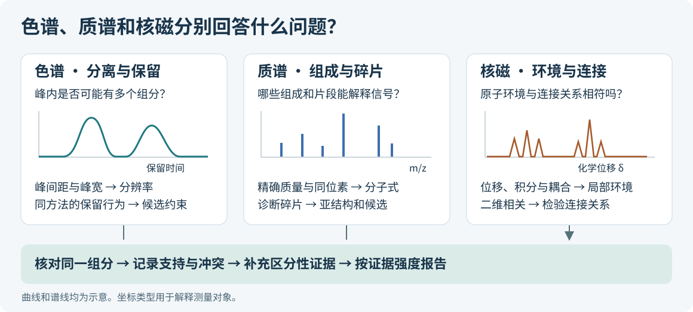

# 第10章｜质谱、色谱、核磁与结构解析

面对一个未知峰，先问峰内有几个组分，再问质量和碎片支持哪些候选，最后判断哪些独立测量可以区分候选。本章以小分子为对象。读完应能选择合适的联用方式、识别谱库检索的边界，并根据证据强弱报告分子式、候选结构或确证结构。

## 10.1 色谱分离、保留、峰形、柱效与分辨率

GC 以气体为流动相，利用化合物的挥发性和它们与固定相相互作用的差异进行分离。低挥发性或热不稳定的组分通常优先考虑 LC。反相 LC 常用疏水固定相与含水流动相。流动相组成、pH、温度和梯度都会影响保留，保留时间应随方法条件一起报告。

在等度 LC 或等温 GC 的常见教学模型下，保留因子 k = (tR − tM)/tM，其中 tR 是保留时间，tM 是不保留组分的通过时间。相邻峰的选择性 α = k₂/k₁，规定 k₂ > k₁ > 0。对近似高斯的峰，用基线峰宽 w 估算理论塔板数 N ≈ 16(tR/w)²。相邻峰的分辨率 Rs = 2(tR₂ − tR₁)/(w₁ + w₂)。峰宽相同且均为 0.20 min、峰顶相距 0.30 min 时，Rs = 1.50。选择性决定峰间距，柱效影响峰宽，二者都影响分辨率。强拖尾、大小悬殊和实际信噪比会改变分离判断。详见[仪器分析教材与保留指数资料](../resources/annual/2026-2027/references/G10-bibliography.md#separation)。

## 10.2 GC、LC 及其与质谱和核磁的联用

| 联用方式 | 常见输入 | 直接观察 | 选择与限制 |
|---|---|---|---|
| GC–EI–MS | 可气化且在进样条件下稳定的化合物，或合适的衍生化产物 | 保留时间和 EI 碎片谱 | 可结合 EI 谱库与同类固定相上的保留指数。衍生物与原化合物需分别记录。 |
| LC–ESI–MS/MS | 可溶且能形成离子的化合物 | LC 保留、前体离子、产物离子 | 可处理低挥发或热敏组分。需记录离子模式、加合形式、碰撞能量和隔离窗，并检查基质抑制。 |
| LC–NMR 或离线馏分 NMR | 可分离且有足够量的组分 | 化学位移、耦合和二维相关 | 适合检验连接关系。灵敏度、溶剂信号、馏分纯度和采集时间限制可行性。 |

选择方法时先看样品性质和待解决的结构歧义。某 LC 峰若有多个离子，先检查它们是否为同一分子的同位素峰或加合离子。质谱与 NMR 分别采集时，记录馏分编号、峰归属和可能的样品转化，以便确认两套谱指向同一组分。详见[仪器分析、ESI 与核磁资料](../resources/annual/2026-2027/references/G10-bibliography.md)。

## 10.3 离子化、质量分析、碎片与同位素信息

质谱仪依次生成离子、按质荷比 m/z 分析离子并记录相对信号。EI 常产生较丰富的碎片，分子离子可能很弱或缺失。ESI 常见质子化、去质子化和金属加合离子，具体离子形式随样品和条件变化。四极杆可筛选前体离子，飞行时间分析器按飞行时间区分 m/z，Orbitrap 从离子运动频率推算 m/z。串联质谱先选择前体，再激发并测量产物离子。参考谱比较需核对离子形式、激发方式和碰撞能量。

分辨本领 m/Δm 表示能否分开邻近峰，Δm 需注明定义，例如半峰高峰宽。质量误差 ppm = 10⁶ × (m观测 − m理论)/m理论。若观测 m/z 为 181.0715，理论值为 181.0707，误差约 +4.4 ppm。应先确定电荷和加合离子，再把精确质量换算为中性分子质量。相邻 ¹³C 同位素峰的 m/z 间距约为 1.00335/|z|。一个氯原子常使 M 和 M+2 呈约 3:1，其他元素和重叠峰会影响实际峰型。精确质量、同位素分布和碎片损失合用可缩小候选分子式。详见[离子化与分子式参考资料](../resources/annual/2026-2027/references/G10-bibliography.md#mass)。

## 10.4 峰检测、对齐、反卷积与保留指数

总离子流图 TIC 汇总各扫描的离子信号，提取离子流图 EIC 跟踪指定 m/z 或质量窗内的信号。定峰前检查基线、空白、信噪比和峰边界。跨样品对齐依据保留时间、m/z 及必要的同位素或碎片证据，减少漂移导致的错配。单纯按时间接近合并，可能将邻近的不同物质归为同一特征。

共洗脱时，比较代表离子的峰顶和峰形，利用扫描间的强度变化尝试反卷积。如果离子轮廓高度重合、信噪比过低或峰采样不足，分解会不稳定。此时应改进分离、重采或降低结论等级。

程序升温 GC 中，待测峰 x 位于相邻正构烷烃 Cₙ 和 Cₙ₊₁ 之间时，线性保留指数 LRI = 100 × [n + (tₓ − tₙ)/(tₙ₊₁ − tₙ)]。6.0 min 和 8.0 min 的 C₈、C₉ 夹住 7.6 min 的未知峰，得到 LRI = 880。等温 Kováts 指数使用调整保留时间的对数关系。跨方法比较前核对固定相、温度程序和参考来源，并记录实测不确定性。详见[保留指数原始论文、NIST 与反卷积文献](../resources/annual/2026-2027/references/G10-bibliography.md#separation)。

## 10.5 谱库相似性、近邻检索与开放集 Top-k

检索时根据前体、离子模式、质量范围和适用的仪器条件筛选谱库，再按质量误差窗口匹配峰。对齐后，普通余弦相似度为 Σxᵢyᵢ/√(Σxᵢ²Σyᵢ²)，其中 xᵢ、yᵢ 是对应 m/z 的强度，未匹配位置可置零。实际检索还会使用强度或 m/z 加权。评价命中时同时记录匹配峰数、解释强度、前两名分差、谱库版本和采集条件。

Top-k 表示前 k 个候选。当真实物质可能不在库中时，应设置开放集拒判，并按库内与库外样本分别评估。库内用 Top-k 命中率，库外用错误接收率，同时记录覆盖率和重复谱是否泄漏到测试集。本包三个样本用于演示判断流程，教学阈值在实际应用前需用代表性样本校准。详见[NIST 谱库算法与 GNPS 原始论文](../resources/annual/2026-2027/references/G10-bibliography.md#search)。

## 10.6 结构到谱图的正向预测

输入候选结构与实验条件，输出预测的碎片 m/z 和强度，用于给缺少实测谱的候选排序。传统方法可枚举断键或构建碎裂图。FIORA 用化学键的局部环境建模，并生成可用于比对的 MS/MS 预测谱。评估时将已知结构的实验谱与预测谱比较，尽量按分子或骨架划分数据，核对电离方式、加合离子和碰撞能量。结构近似的候选可能拥有相近的预测谱，排名仍需实验复核。详见[前沿比较与 FIORA 原始研究](../resources/annual/2026-2027/references/G10-bibliography.md#frontier-sources)。

## 10.7 谱图到亚结构、分子式与候选生成

反向任务从观测谱推断分子式、亚结构或候选结构。可先用精确质量、同位素峰型和元素约束筛选分子式，再用 MS/MS 碎片和中性损失构建结构约束。SIRIUS 4 将碎裂树用于整理碎片证据，并通过 CSI:FingerID 预测分子指纹和检索结构库。数据库覆盖会影响候选召回，分子式确定之后仍可能有多个位置异构体或立体异构体。

MetGenX 先用相似谱找结构模板，再根据模板生成候选并重排。它扩展了固定候选清单之外的搜索范围。其表现与相似模板的可用性相关，生成结构应按原始谱、分子式、可比保留行为和补充实验逐项核验。比较不同研究时，先区分谱库检索、结构库检索和从头生成，并确认测试划分与候选池一致。详见[反向解析论文和 2026 年原始研究](../resources/annual/2026-2027/references/G10-bibliography.md#frontier-sources)。

## 10.8 MS、NMR、IR 和保留信息的证据矩阵

¹H NMR 中的化学位移反映局部电子环境，适当采集条件下的积分支持氢数判断，耦合和裂分有助于判断邻近关系。¹³C NMR 提供不同碳环境。COSY 追踪有标量耦合的质子网络，HSQC 常连接直接成键的氢和碳，HMBC 常观察跨两或三键的长程相关。相关峰也受耦合常数、弛豫、谱峰重叠与采集条件影响。IR 可支持羰基等官能团的判断，其吸收带需结合分子其余信息归属。

| 证据 | 可支持的结论 | 下一步核验 |
|---|---|---|
| HRMS 精确质量与同位素 | 缩小元素组成和分子式 | 检查电荷、加合形式和同位素模式 |
| EI 或 MS/MS 碎片 | 支持亚结构并重排候选 | 核对采集条件及诊断碎片，检查混合谱 |
| 同条件 RI 或保留时间 | 检查候选的保留行为 | 确认固定相和程序，测标准品并比对谱图 |
| ¹H、¹³C 与 2D NMR | 检验骨架和连接关系 | 对照化学位移、积分及相关峰，评估纯度与重叠 |
| IR | 支持官能团约束 | 比较诊断吸收与可能重叠的振动带 |

例如，候选为乙苯与对二甲苯时，两者分子式均为 C₈H₁₀。干净馏分中，乙苯乙基预计给出积分约 2:3 的四重峰和三重峰，对二甲苯的两个等价甲基预计给出总积分约 6H 的单峰。这是补测前的可检验预期，结果须由实际谱图确认。报告可借鉴 HRMS 鉴定置信框架，按证据给出分子式、暂定候选、可能结构或标准品确证，并明确尚未解决的异构问题。详见[核磁与鉴定置信度资料](../resources/annual/2026-2027/references/G10-bibliography.md#confirmation)。

## 前沿比较与实践

| 方法 | 输入与输出 | 证据边界 |
|---|---|---|
| FIORA（2025） | 分子结构与条件 → 小分子预测 MS/MS 谱 | 补充实测谱库覆盖。训练覆盖、碎裂机制与条件偏差影响排序。 |
| DreaMS（2025 在线，2026 卷期） | MS/MS 峰表 → 学习型谱图表示，可作近邻检索 | 用遮蔽峰和保留次序做自监督预训练。需按样本来源、仪器条件及结构相似度检验迁移。 |
| MetGenX（2026） | MS/MS 与检索到的结构模板 → 生成候选结构 | 评价时区分候选库限制和库外生成。异构体仍需保留行为、标准品或 NMR 验证。 |

三项研究分别改进预测参考谱、谱图表示和候选生成。它们的输入、任务和评估条件不同，本章采用各论文的任务设定解释结果。详见[三项原始研究和年度前沿更新卡](../resources/annual/2026-2027/references/G10-bibliography.md#frontier-sources)。

从 <a href="./assets/labs/g10/index.html" target="_blank" rel="noopener">交互练习</a> 选择 U01，比较纯谱图和融合排序，再调整保留指数容差。随后用 U02 检查共洗脱风险，用 U03 检查候选接近时的拒判。迁移到固定相不同的样品时，判断哪些证据还能使用以及还需补测什么。输入、公式和完整输出见[案例说明](ch10-g10-supplement.md)，课后可做[传承题](../resources/annual/2026-2027/questions/G10-questions.md)。
