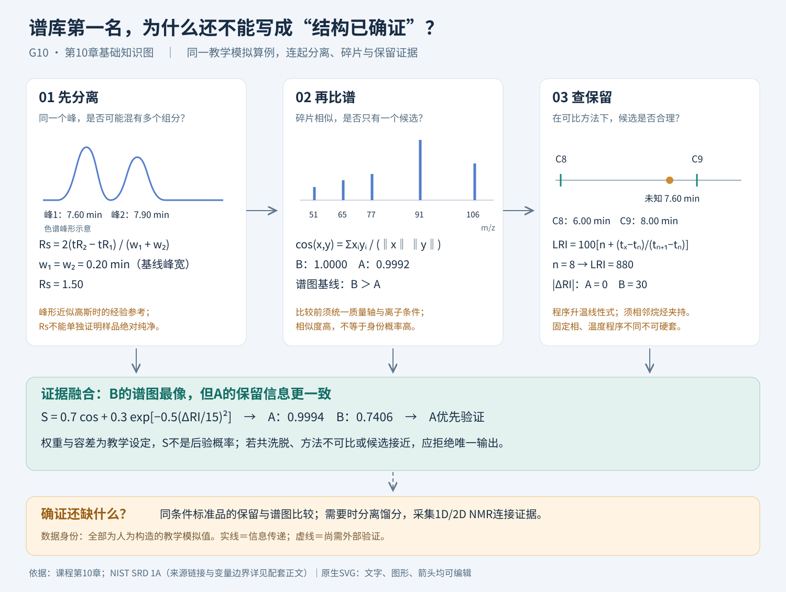
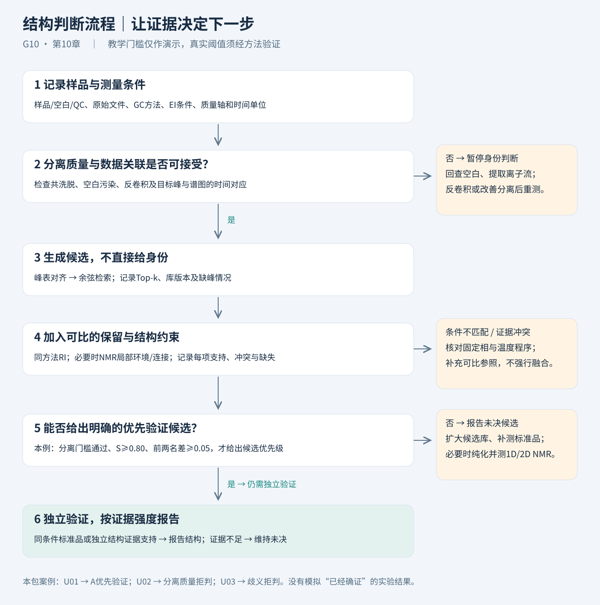

# G10 章节补充｜把谱库排名变成可审查的结构证据链

## 问题卡与学习目标

对应第10章 10.1、10.4、10.5 与10.8。本次只解决一个问题：当 EI 谱库最相似候选与保留证据冲突时，如何保留多个假设、发现失效并决定下一项测量？

完成后应能计算基线峰宽定义下的分辨率、普通余弦相似度和程序升温线性保留指数；比较谱图基线与多证据排序；解释“候选优先级”和“结构确证”的区别。

## 基础知识图及符号

图中蓝色表示测量与处理，青色表示证据计算，橙色表示冲突和拒判。实线箭头表示信息传递，虚线表示仍需外部验证。文字、箭头和图形均为原生 SVG 元素，可在 Inkscape、Illustrator 等工具中编辑；没有嵌入位图或把文字转成轮廓。

**分离回答“是不是同一组分”。** 基线峰宽分别为 w₁、w₂，保留时间为 tR₁、tR₂ 时，Rs = 2(tR₂−tR₁)/(w₁+w₂)。两峰时间 7.60 和7.90 min、基线峰宽均0.20 min，得到 Rs=1.50。这个常用经验参考适合近似高斯且峰形相近的情况；拖尾、浓度差、噪声和质谱离子选择性会改变判断，不能仅凭 Rs=1.5 宣称任意样品都已纯化。

**质谱回答“哪些候选能解释碎片”。** 将未知谱 x 与参考谱 y 对齐到同一 m/z 轴，用 cos(x,y)=Σxᵢyᵢ/[√Σxᵢ²√Σyᵢ²] 衡量谱形相似。本例只用名义整数 m/z 和非负相对强度，不作峰权重变换；缺失峰补零，重复 m/z 强度相加。零向量没有可定义的余弦，程序显式拒绝。这里的普通余弦不是 NIST 软件的专有匹配因子，也不是身份概率。真实 EI 谱要匹配离子化条件、能量、质量范围与背景处理；不能直接拿 ESI–MS/MS 谱与 EI 谱比较。

**保留回答“这个候选在相同方法下是否合理”。** 程序升温 GC、相邻正构烷烃 Cₙ 与 Cₙ₊₁ 夹持未知峰时，线性保留指数 LRI=100[n+(tR,x−tR,n)/(tR,n+1−tR,n)]。本例 n=8，两个烷烃时间6.00、8.00 min，未知7.60 min，LRI=880，无量纲。这里不是等温 Kováts 指数的对数公式。RI 也不能跨任意固定相和温度程序直接照搬；比较时须保留方法条件、参照来源和误差范围。烷烃不夹持未知峰时程序拒绝外推。

批次 B 的三个对齐锚点相对参照均晚0.20 min，取差值中位数 δ=0.20 min，并对该批时间作 t校正=t原始−δ。本例只处理整体平移，不处理伸缩、非线性漂移和换序。LRI 若同时使用同批烷烃和未知峰计算，对整体平移本就不敏感；这里对齐用于教学与跨批时间检查，不能把“对齐成功”与“RI一致”重复计作独立证据。

## 可复现案例

输入为 `code/ch10_g10/data/` 的四个 CSV。`spectra.csv` 是峰表；`candidates.csv` 是教学参考 RI；`peaks.csv` 记录样品时间、分离质量和批次；`anchors.csv` 记录已知对齐标记。离子模式为 EI 正离子、教学标称70 eV；名义质量轴单位写作 m/z，时间单位为 min。所有数字都是设计值。

U01 在 m/z 51、65、77、91、106 的相对强度为8、12、16、100、28。B 的参考谱恰与其相同，因而谱图基线把 B 排第一，但 A 的谱形也非常接近。加入保留约束后，B 的 RI 差30、A 的 RI 差0，因此排序改变。

教学融合分数：SRI=exp[−0.5(ΔRI/σ)²]；S=0.7 cos+0.3 SRI，默认 σ=15。权重与 σ 是预先声明的教学设定，未用独立实验校准，不是贝叶斯后验。谱图与保留信息相关时，也不能简单称其为独立似然相乘。

预先声明的教学决策规则：Rs&lt;1.0 时暂停身份排序；最高 S&lt;0.80 或第一、第二名差&lt;0.05 时拒判；即使通过规则，也仅给出优先验证候选。1.0、0.80、0.05 均不是行业通用阈值，真实工作须用标准品、空白、阴性和外部样品确定性能。缺失 RI 时不能套用当前融合阈值，须回到单谱候选报告或重新校准评分。

| 样本 | 设计情境 | 仅谱图基线 | 加 RI 后的行为 | 合理表述 |
|---|---|---|---|---|
| U01 | 分离可接受，谱形与保留冲突 | B 第一 | A 第一，通过教学门槛 | A 是优先验证候选；仍未确证 |
| U02 | Rs=0.70，共洗脱风险 | 可产生看似合理的排名 | 在分离质量关卡拒判 | 先回查提取离子流、反卷积或改善分离 |
| U03 | LRI=895，在 A、B 中间 | B 第一 | A、B 得分过近，拒判 | 需要新证据区分，不能强行唯一输出 |

精确数值见运行生成的 `results/ranking.csv` 和 `results/report.md`；`comparison.svg` 对比三例得分并标注失败对象；`sensitivity.csv` 展示 σ=5、15、30、60 对U01的影响。σ 放宽至60时，A/B难以分开，原先的“首选明确”变为拒判，说明判定依赖保留证据容差，不能只展示一个有利参数。

## 结构证据矩阵：应保留缺口

| 证据 | U01 对 A 的支持 | U01 对 B 的支持 | 不能推出什么 |
|---|---|---|---|
| EI 谱图 | 高相似度 | 完全匹配教学向量 | 不足以唯一排除异构体、共洗脱或库外结构 |
| 同方法 RI | 差0，支持 | 差30，削弱 | 方法不一致时不能沿用这一差值 |
| 分离质量 | Rs=1.50，允许进入本教学流程 | 同左 | 不证明绝对纯度 |
| 标准品同条件共进样 | 未提供 | 未提供 | 不能声称已确证 |
| 分离馏分 NMR / 2D NMR | 未提供，可检查局部连接 | 未提供，可寻找排他信息 | 不得写出“已测得”位移或相关峰 |

在未知样品上可先以标准品同条件保留与谱图比较进行验证；需要更强连接信息时，分离足量馏分并采集1D/2D NMR。NMR 的化学位移反映局部环境，积分与核数有关，耦合及COSY、HSQC、HMBC等提供连接约束；重叠、交换、浓度、溶剂和灵敏度会限制解释。补测选择应针对剩余候选的差异，不是机械叠加仪器数量。

## 结构判断流程

流程图的“是/否”对应可检查条件：分离与空白是否合格、参考方法是否可比、证据是否冲突、标准品或独立结构证据是否支持。质量关卡失败时先回查数据；候选不足时扩大候选空间；验证前只报告候选及缺口。

## 前沿与传承

前沿卡见 [FIORA](../resources/annual/2026-2027/references/G10-frontier.md)，题目见 [下一届传承题](../resources/annual/2026-2027/questions/G10-questions.md)。本案例是可诊断基线，供未来与预测谱或学习型相似度作公平比较。未来扩展应按化合物或骨架分组，隔离同物质的重复谱，再用新批次、库外候选与弱信号样品验证；报告 Top-k、误判和拒判率，而不是把这三个设计样本当成独立性能测试集。

## 依据

- [课程任务地图](https://oaham725.github.io/intelligent-analytical-chemistry/#/docs/course/task-map)：G10指定“谱库匹配或峰表处理案例；结构判断流程图”。
- [第10章](https://oaham725.github.io/intelligent-analytical-chemistry/#/docs/ch10)：余弦、分离、多证据证据链与失败样本。
- [评分与署名](https://oaham725.github.io/intelligent-analytical-chemistry/#/docs/course/rubric)及[提交流程](https://oaham725.github.io/intelligent-analytical-chemistry/#/docs/course/workflow)。
- [NIST SRD 1A 官方页](https://www.nist.gov/srd/nist-standard-reference-database-1a)：真实 EI、MS/MS 和 GC 保留指数参考库。本案例未使用其商业数据。
- [NIST Chemistry WebBook 保留数据说明](https://webbook.nist.gov/chemistry/gc-ri/)：后续查找真实 GC 保留指数与方法条件的入口。

### 贡献记录（待真实合并后填写）

学年为2026–2027。贡献者填写本人同意公开的姓名或笔名；工作内容按实际分工记录；关联 PR 采用真实合并编号。当前不填写虚构署名和合并状态。
