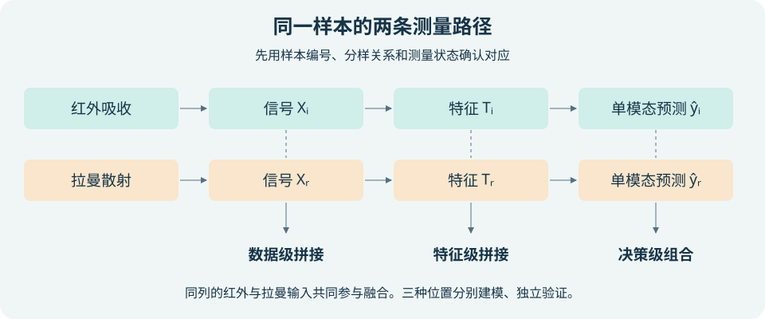
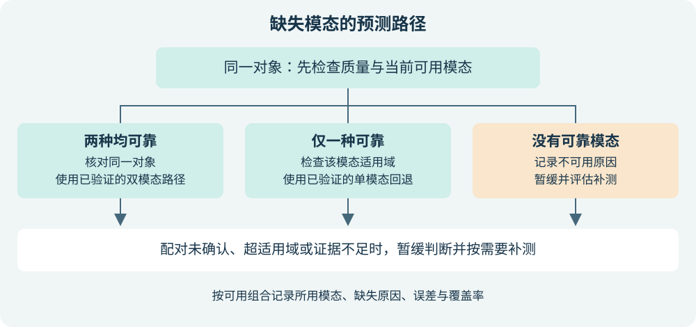

# G13 多模态分析：红外与拉曼何时值得融合？

> 第4篇　跨模态、标准化与可信智能分析
>
> 第13章《多模态基础模型与知识增强分析》补充案例

## 章首导引

实验室已有一套红外定量方法。现在又能测拉曼，要怎样证明多测一次值得？如果某些配方容易产生荧光、因而常缺拉曼，双模态模型在能测齐的样品上误差更低，能否据此直接上线？

回答这两个问题需要三类证据。第一，两种测量确实针对同一分析对象，并可能看到与目标有关的不同信息。第二，在共同的独立测试对象上，融合相对可信的单模态基线有增益。第三，部署时测不到、测不准或遇到新批次的样品有经过验证的处理路径。本文用振动光谱与食品定量作为例子，补充教材第 13.1、13.2、13.6.2 和 13.7 节。教材原有的谱图—结构共享表示和跨模态检索可以沿用同样的证据检查。[10]

## 学习目标

- 确定分析目标、物理样本单位和跨模态配对键，识别样本对齐与信号对齐的区别。
- 用红外和拉曼的选择定则提出一个可检验的互补假设，并设计单模态基线与融合对照。
- 比较三种融合位置，并按缺失阶段和原因选择回退、决策融合、缺失感知训练、插补或补测。
- 区分原作者结果、教学推演和本作业实际完成的检查。

## 本章知识图谱

**图 1　同一样本的两条测量路径与三种融合位置。** 自绘，融合分类参照 [2]。每行表示一种测量。横向箭头表示从信号 X 到特征 T，再到单模态预测 ŷ。竖向虚线连接两路同类型输入，表示融合需核对它们是否对应同一对象。下方箭头标出可选择的融合位置。各层级是分别比较的候选方案。仅当对应关系、采样状态与质量符合任务要求时，才能把两路结果作为同一对象的联合证据。

## 13.A.1 从分析对象定义模态

**模态**是对分析对象的一种观测方式，由测量机制和数据生成过程定义。对同一份混合物测 FTIR 与拉曼，得到吸收谱和散射谱，是两种模态。一条 FTIR 光谱的数千个波数强度是同一模态的多个变量。反复测同一份样品得到重复测量，可用于估计测量波动。独立样本量仍取决于独立样品或制样组的数量。[1–2]

同一框架也适用于光谱与显微成像、色谱与质谱、谱图与结构记录。图像可以补充空间分布，谱图可以提供分子结构线索。批号、仪器和时间首先用于追踪来源与分层检验。若某项元数据在部署时才缺失，或只有在知道真值后才生成，就不能用它做训练输入。

### 13.A.1.1 两个层次的对齐

| 检查层次 | 问题 | 红外与拉曼示例 |
|---|---|---|
| 对象对应 | 两条记录能否追溯到同一物理对象？ | 用样本 ID 和分样记录连接两套数据。用母样或独立制样组 ID 保证同源数据在同一划分中。 |
| 观测对应 | 两次测量是否代表目标需要的状态、时间和尺度？ | ATR 红外偏向接触面，显微拉曼可能仅覆盖局部。如果目标是组织区域识别，须核对区域。如果目标是整体组成，须解释采样代表性。 |

每条观测至少记录样本 ID、模态、重复扫描 ID、仪器、批次、测量条件和质控状态。制样表另记录母样、制样组与参考目标值。先检查重复键、未匹配记录与一对多关系，再决定按样本汇总还是保留测点。IR 的吸收波数与 Raman 位移可以各用自己的网格。拼接时对齐的是样本行，各模态的校准或重采样在各自的波数轴上完成。

## 13.A.2 互补必须针对具体任务

### 13.A.2.1 为什么同一种振动会有不同表现

在常用的一阶振动近似下，正常坐标 Q 的变化若能改变偶极矩，振动可在红外吸收中活跃。若能改变极化率张量，振动可在拉曼散射中活跃。极化率描述电子云被外电场扰动的程度。对理想中心对称分子的基频，红外与拉曼满足互斥规则。例如 CO₂ 的反对称伸缩在红外活跃，对称伸缩在拉曼活跃。非中心对称分子的某些振动可以在两种光谱上同时出现。谱带强度和是否可辨认还取决于仪器、样品与测量条件。[3]

真实混合物包含更多限制。水吸收可能遮盖中红外的部分谱区，ATR 接触状态会改变响应。拉曼光谱可能受荧光背景或激光加热影响，测点也可能偏向某个组分。选择定则解释两种观测为什么可能不同，质控与样本对齐决定这些差异能否进入比较。[3–4]

### 13.A.2.2 把“有用”写成可以被推翻的假设

以估计掺假比例为例，先拟定假设：在红外信号相近且采样状态一致的样品中，拉曼仍包含与目标有关的成分差异。用红外建立基线，再在独立样本上比较融合模型。若增益只发生于单一批次，应检查拉曼是否恰好识别了该批次的背景。若对多个批次均有改善，可进一步检查候选谱段和误差分布。即便结果符合谱带归属，也仍需独立对照才能支持化学机制解释。

另一种可检验的收益来自**误差互补**。在同一批留出对象上观察两种模型的误差方向。若两者均有可接受的偏差且误差相关较低，组合可能比任一模型稳定。若两者随仪器漂移一起偏高，平均两个估计仍可能偏高。应同时检查误差大小、方向和按批次的分布。

## 13.A.3 三种融合策略的公平比较

| 层级 | 输入与流程 | 对齐、尺度与预处理 | 适用条件与实现代价 | 主要风险 |
|---|---|---|---|---|
| 数据级（早期） | 各自预处理后拼接两块整谱变量，再用 PLS 等方法拟合 | 配对行必须一致。每块检查自己的波数网格、背景、量纲和块权重 | 保留细节。拼接易实现，有效配对样本偏少时，高维模型与参数选择更难验证 | 高维块、噪声背景或冗余峰可能支配建模 |
| 特征级（中间） | 分别提取峰面积、峰比、主成分或 PLS 得分，再拼接建模 | 逐样本配对。各块特征要检查尺度，提取器在训练折拟合 | 降维后可作为本科项目的小样本候选。需说明为何选峰或选潜变量，实现难度中等 | PCA 优先保留方差，可能舍弃低方差但与目标有关的信号。监督选峰若跨集合会泄漏 |
| 决策级（后期） | 各模态单独建模，再组合回归值、校准概率或投票 | 单模态训练可各用有标签的样品。同一对象的输出才能合并，学习组合权重还需共同校准对象 | 便于替换仪器或设置回退。平均易实现，校准、组合验证及维护多个模型更费工 | 可能损失跨模态细节。未经校准的置信度可能使较弱模型权重过高 |

上表依据化学计量学中的融合分层整理。数据需求是相对判断，受目标复杂度、有效维度、独立制样组数和批次覆盖影响。[2,4]

**同一任务的三条路径。** 对掺假比例，数据级把预处理后的两套光谱横向拼接，特征级可分别提取两组潜变量后拼接，决策级则分别估计同一比例再加权。最简的决策级回归可以写作 ŷ = w × ŷᵢ + (1 − w) × ŷᵣ。权重 w 由独立校准集或训练集折外预测估计，最终测试集用来检验已固定的组合。

**为什么逐列标准化仍可能不够。** 若两块变量均缩放至单位方差，一块有 p 个变量，其总方差约为 p。于是较多变量的一块仍会对距离或潜变量产生较大影响。可用训练折估计块范数并做块缩放，再与不缩放方案比较。块权重应当由目标相关性和验证证据支持，机械等权可能压制真正的信息优势。

## 13.A.4 哪些偏差会伪装成融合增益

| 风险 | 可能出现的假象 | 检查办法 |
|---|---|---|
| 样本错配 | 光谱行数相同就按顺序拼接，偶然联系被模型利用 | 核对样本键、分样、时间和重复记录，统计未匹配或多重匹配 |
| 批次或仪器混杂 | 品牌只在特定日期采集，模型从漂移推断品牌 | 按批次或仪器留出，检验跨批表现。完全混杂时需补足跨批交叉覆盖 |
| 尺度与维度失衡 | 高量纲或变量多的模态支配模型 | 在训练折比较逐列和块级缩放，检查模态消融 |
| 噪声与冗余叠加 | 两台仪器共同响应环境变化，重复证据让模型过于自信 | 核查空白、重复性、两模型残差相关与误差方向 |
| 数据泄漏 | 同源样本的扫描跨训练和测试，或用全部数据预先选峰 | 先按物理样本或母样分组划分，数据驱动的预处理和调参均在训练折完成 |
| 选择性缺失 | 易失效的配方从完整子集中消失，完整子集表现偏乐观 | 记录缺失原因，按配方、质量和批次统计缺失率、误差及覆盖率 |

### 13.A.4.1 一套最小验证协议

1. **预先定义目标与单位。** 例如目标为混合物中某成分的质量分数。独立单位应能追溯到物理样品及制样组。对同一母样的分样或重复扫描不要拆开。
2. **锁定测试边界。** 留出制样组作为独立测试。有足够批次时另做留批次检验。样品可配对但品牌与仪器完全重合时，跨域结论缺少可辨识的证据。
3. **建立两类比较。** 先用相同完整训练样本比较 IR、拉曼和三类融合，以分辨方法差异。随后允许各单模态模型使用所有合格的有标签训练样本，检验真实部署中的回退。报告两类比较的训练样本构成。
4. **对同一留出对象评价。** 回归报告样本数、RMSEP 与平均有符号误差。RMSEP 是预测误差平方平均后开根号，与目标采用同一量纲。比较“较最佳单模态的下降”时，应报告使用的基线、分母和同一测试集。分组重采样或多批次检验可反映差异的稳定性。
5. **分开报告压力测试和实际缺失。** 在副本上遮挡或扰动配对可检验脆弱性。真实缺失与批次留出结果单列。给出一个失败对象的分析线索，例如荧光失效、超适用域或两种估计冲突。

## 13.A.5 缺失模态的处理与验收

**训练时缺失**改变可以学到的配对关系。完整病例训练可能丢失恰好最难测的一类样本。先按缺失模式盘点样本数、标签、批次与质控，再决定能否学习联合模型。**预测时缺失**改变当前对象可以走的路径。先将质控不合格视为不可用并记录原因，再调用经过验证的路径。两种阶段可能同时发生。[5–6,11]

| 方案 | 使用条件 | 必须检查的失效边界 |
|---|---|---|
| 单模态回退 | 对应模型在当前模式、真实缺失子群和适用域内验证过 | 可用信号本身不合格、遇到新仪器或罕见配方时暂缓 |
| 按可用模态做决策融合 | 每个输出可信，校准或加权规则对当前组合有效 | 输出必须对应同一对象。只有一份可靠输出时走单模态路径 |
| 缺失感知或模态 dropout | 有代表性训练样本，用掩码记录实际可用性，或训练中遮挡整个模态 | 随机遮挡覆盖不了与配方、浓度或荧光相关的所有真实缺失，需在这些子群验证 |
| 插补 | 有可核实的配对训练数据，跨模态映射相对稳定 | 在留出的实测谱上检查重构和下游误差，明确标为估计值，保留缺失标记并报告不确定性 |
| 暂缓判断或补测 | 无可靠信号、超适用域、结果冲突或关键判断风险过高 | 预先定义暂缓与补测条件，报告覆盖率和已判样本误差，避免只展示容易判断的样本 |

### 13.A.5.1 用荧光失效检查部署方案

考虑深色配方更容易产生荧光的情境。若缺失主要由已记录的仪器故障引起，可以按仪器和停机时段检查覆盖。若在相同记录条件下，拉曼缺失仍与未观察到的组分有关，仅依赖观测数据通常难以确定缺失机制。对近似随机的遮挡实验和现实缺失组分别检验，再对相关假设做敏感性分析。

预测时只有红外，先检查红外质控和当前对象是否在红外回退模型适用域内。如果任务是安排复核顺序，可报告估计值和使用模态。如果输出会触发重要处置，且预测区间跨过预定阈值，则暂缓或补测。覆盖率为作出判断的样本数除以待判断样本总数。比较拒判策略时应同时报告覆盖率与已判对象误差。

研究插补时还要加入一个对照：直接用已有模态预测。如果“生成拉曼再融合”在独立真实样本上的下游结果无法超过这个基线，就缺少为插补增加复杂度的理由。即使平均谱形接近，低丰度成分的关键峰也可能无法恢复，插补谱应与实测谱分开归档。

**图 2　缺失模态的预测路径。** 自绘。先按当前对象的质控、配对和适用域判断可用性，再按可用模态数进入候选路径。输出条件不满足时转为暂缓或补测。质量不合格与未采集可共用回退逻辑，原因应分开记录。训练阶段为每条路径准备代表性数据与验证记录。

## 13.A.6 原始研究的证据拆解

### 13.A.6.1 蜂蜜中高果糖糖浆定量（出版社摘要、方法预览与结论）

Li 等以实验配制的蜂蜜—高果糖糖浆混合物为对象，用中红外（MIR）和拉曼估计糖浆含量。作者以偏最小二乘回归（PLS）建立单模态模型，比较数据级、特征级和三种决策级方案。决策级在各模态分别得到回归预测后组合输出。本案例只使用出版社公开可见的摘要、方法预览与结论，未取得完整拆分记录。[4]

作者报告，三种决策级方案的预测集均方根误差（RMSEP）均低于中红外单模态（1.93）、拉曼单模态（2.30）、数据级融合（2.09）和特征级融合（3.37）。数值沿用原文报告尺度，公开片段不足以核对单位细节、具体组合权重和独立制样分组，因此不据此推断商业蜂蜜、新来源或拉曼缺失场景的表现。[4]

对 G13 的启发是，完整样本中，组合两条单模态预测可能比直接拼接更合适。要判断拉曼缺失时能否退回中红外，仍要另设真实缺失子群，并检验中红外单模态路径。

### 13.A.6.2 榛子储藏变化识别（出版社全文）

Lösel 等用傅里叶变换近红外（FT-NIR）和空间偏移拉曼（SORS），区分榛子储藏前后的样品。作者对预处理后的光谱进行数据级拼接并缩放，用线性判别分析分类。近红外分别比较冻干与未冻干样品，SORS 测未冻干材料。每种储藏条件单独评价。研究在六个批次间轮流留出一个批次，另外五批用于训练，以 Cohen’s κ 衡量预测与参考标签的一致程度。[7]

作者报告，未冻干 FT-NIR 与 SORS 的融合在所考察条件下均未超过对应最佳单模态。使用冻干 FT-NIR 时，三种加速短期储藏条件仍未获得融合改善，但在两种贴近实际的长期储藏条件下表现改善。作者指出，冻干后水带附近部分变量可为 SORS 提供额外信息。这个解释来自作者对谱区与分类结果的分析。[7]

对 G13 的启发是，互补性会随样品处理和部署条件改变。六个批次的轮流留出能检查本研究范围内的批次外表现。若现场无法冻干，便不能把冻干条件下的融合结果直接作为现场性能证据。本案例的近红外主要涉及倍频和合频吸收，不能直接套用前文讨论中红外基频的例子。

**对照阅读。** 蜂蜜研究说明融合层级会影响定量误差。榛子研究说明即使融合层级相同，储藏条件和样品处理也会改变是否观察到增益。两项研究的任务、指标和验证设计各异，不能直接比较数值大小。

### 13.A.6.3 数据可用性与本作业范围

**本作业实际运行的数据检查。** 食用油公开存档 [13] 同时提供 FTIR 和拉曼。原论文的仪器与样品段说明了样品和重复测量 [12]。下载文件与 Zenodo 公布的 MD5 一致。解包实际得到 4 个 XLSX 工作簿。用 <a href="./code/ch13_exercises/audit_olive.py" download>谱标题核查脚本</a> 读取每个首张表的第一列，跳过表头和空值，仅去除两端空白，再统计完全相同的标题。

| 子研究 | FTIR 记录数（不同标题数） | Raman 记录数（不同标题数） | 完全相同的标题数 |
|---|---:|---:|---:|
| 分类 | 438（434） | 144（143） | 0 |
| 定量 | 81（80） | 30（30） | 2 |

上表为本作业运行结果，记录数包含重复测量或不同导出记录。分类表不能按完整标题直接连接。定量表的两个共同标题在各表均只出现一次，仍须有物理样本及分样记录才能确认配对。两模态导出粒度和命名方式可能不同，标题交集也不能用来估计真实的配对比例。此次没有核实可用于建模的跨模态样本键及母样分组，因此未按行号、相似标题或标签强行连接，也未据此报告性能。

蜂蜜论文的公开页面未见可直接核对的原谱矩阵 [4]。榛子研究另有 Zenodo 公开双模态存档 [14]。本作业核查了存档说明，未解包审核内部样本键，也未复现该研究的性能。另外筛查的 NeurIPS 多谱数据是模拟的，模态清单无拉曼 [8]，RamanLab 存档未核实有同一实体对应的 FTIR 与任务标签 [9]。本作业的实作范围是食用油元数据核查和可复跑的教学规则演练。未转载原谱，未进行模型训练、性能复现或光谱生成。

## 13.A.7 前沿更新与本章小结

<a href="#/resources/annual/2026-2027/references/ch13-ir-raman">2026–2027 学年前沿更新卡</a> 以缺失模态综述为依据，将训练和部署阶段的缺失分开组织。它对本章的hus实际改变是：评估应按可用模态组合和批次报告，不能只看完整样本的总体误差。较早的 ModDrop 原始研究在手势任务中尝试训练时遮挡输入通道，Ma 等的图文研究发现缺失鲁棒性随任务和融合方式变化。这些研究提供方法线索，迁移到光谱仍需用真实缺失、独立批次和单模态基线检查。[5–6,11]

共享表示可以把同一对象的谱图、结构或图像映射到邻近位置，用于检索或辅助判别。训练时应检查错配、同一结构被误作负样本和仪器批次捷径。知识增强可以用选择定则和谱带归属核查候选解释，并区分测量证据与模型生成的结果。[1,3,10]

当两种测量能代表同一对象、各自可靠且第二种测量提供目标相关的增量信息时，融合值得比较。是否采用，应看它在独立对象和部署条件下是否胜过单模态基线。错配、混杂和选择性缺失首先改变的是证据本身，模型复杂度无法补上缺失的验证。回退或补测也需要明确的适用条件。

## 代码实践

打开 <a href="./code/ch13_exercises/ir-raman.html">红外与拉曼融合策略演练</a>，依次完成以下对照。

| 操作 | 预期路径 | 要回答的问题 |
|---|---|---|
| 双模态基线，再把样本量改为偏少 | 从数据级候选转为单模态基线加特征级候选 | 为什么应比较压缩前后的表现？ |
| 选择错配与批次差异，再确认配对 | 从核对样本转为跨批验证 | 为什么配对正确也无法排除批次捷径？ |
| 选择预测缺拉曼，再把两种模态均设为不可用 | 从检查红外回退转为暂缓判断 | 哪些验证证据支持红外模型输出？ |

交互输出是可追踪的教学规则，三个操作展示策略变化。页面不训练模型，不输出实验性能。

## 思考题与计算题

1. 为什么同一块组织的两条谱可能共享样本编号却不能直接联合做局部判别？需要补什么元数据？
2. 逐列标准化后，为什么变量多的一块仍可能占优？怎样设计对照检查影响？
3. 若易荧光样品主要属于一种配方，随机遮挡结果可以检验什么？实际还需报告什么？
4. <a href="#/resources/annual/2026-2027/questions/ch13-ir-raman">传承题与答案要点</a> 给出了从训练到部署的完整情境。

## 参考文献

1. Baltrušaitis T, Ahuja C, Morency LP. Multimodal Machine Learning: A Survey and Taxonomy. IEEE Transactions on Pattern Analysis and Machine Intelligence, 2019, 41(2), 423–443. [DOI](https://doi.org/10.1109/TPAMI.2018.2798607) · [作者稿](https://arxiv.org/abs/1705.09406)
2. Azcarate SM, Ríos-Reina R, Amigo JM, Goicoechea HC. Data handling in data fusion: methodologies and applications. TrAC Trends in Analytical Chemistry, 2021, 143, 116355. [DOI](https://doi.org/10.1016/j.trac.2021.116355)
3. Nakamoto K. Infrared and Raman Spectra of Inorganic and Coordination Compounds, Part A: Theory and Applications in Inorganic Chemistry. 6th ed. Wiley, 2009. 第 1 章选读。 [出版社](https://catalogimages.wiley.com/images/db/pdf/9780471743392.excerpt.pdf)
4. Li Y, Huang Y, Xia J, Xiong Y, Min S. Quantitative analysis of honey adulteration by spectrum analysis combined with several high-level data fusion strategies. Vibrational Spectroscopy, 2020, 108, 103060. [DOI](https://doi.org/10.1016/j.vibspec.2020.103060) · [出版社预览](https://www.sciencedirect.com/science/article/pii/S0924203120300631)
5. Ma M, Ren J, Zhao L, Testuggine D, Peng X. Are Multimodal Transformers Robust to Missing Modality? CVPR, 2022, 18177–18186. DOI 10.1109/CVPR52688.2022.01764. [会议全文](https://openaccess.thecvf.com/content/CVPR2022/papers/Ma_Are_Multimodal_Transformers_Robust_to_Missing_Modality_CVPR_2022_paper.pdf)
6. Wu R, Wang H, Chen HT, Carneiro G. Deep Multimodal Learning with Missing Modality: A Survey. Transactions on Machine Learning Research, 2026. [期刊记录](https://openreview.net/forum?id=tc7RFcx4hT) · [作者稿](https://arxiv.org/abs/2409.07825)
7. Lösel H, Shakiba N, Bachmann R, Wenck S, Le Tan P, Creydt M, Seifert S, Hackl T, Fischer M. Rapid testing in the food industry: the potential of Fourier transform near-infrared (FT-NIR) spectroscopy and spatially offset Raman spectroscopy (SORS) to detect raw material defects in hazelnuts (Corylus avellana L.). Food Analytical Methods, 2024, 17, 486–497. [出版社全文](https://link.springer.com/article/10.1007/s12161-024-02578-w)
8. Alberts M, Schilter O, Zipoli F, Hartrampf N, Laino T. Unraveling Molecular Structure: A Multimodal Spectroscopic Dataset for Chemistry. NeurIPS Datasets and Benchmarks, 2024. [数据项目页及完整引文](https://rxn4chemistry.github.io/multimodal-spectroscopic-dataset/)
9. Celestian A (data curator). Raman Databases for RamanLab software. Zenodo 数据存档，2025. [存档元数据](https://doi.org/10.5281/zenodo.15717961)
10. 《智能分析化学》课程教材编写组. 第13章 多模态基础模型与知识增强分析. 课程在线教材，2026 年 11 月查阅. [章节源文](https://github.com/Oaham725/intelligent-analytical-chemistry/blob/main/docs/ch13.md)
11. Neverova N, Wolf C, Taylor GW, Nebout F. ModDrop: Adaptive Multi-Modal Gesture Recognition. IEEE Transactions on Pattern Analysis and Machine Intelligence, 2016, 38(8), 1692–1706. [DOI](https://doi.org/10.1109/TPAMI.2015.2461544) · [作者稿](https://arxiv.org/abs/1501.00102)
12. Jiménez-Carvelo AM, Osorio MT, Koidis A, González-Casado A, Cuadros-Rodríguez L. Chemometric classification and quantification of olive oil in blends with any edible vegetable oils using FTIR-ATR and Raman spectroscopy. LWT, 2017, 86, 174–184. [DOI](https://doi.org/10.1016/j.lwt.2017.07.050) · [机构库作者稿](https://pure.qub.ac.uk/files/138088993/ms_LWT_D_17_00528R1_CLEAN.pdf)
13. Jiménez-Carvelo AM（数据整理者）. Chemometric classification and quantification of olive oil in blends with any edible vegetable oils using FTIR-ATR and Raman spectroscopy. Zenodo 数据存档，2025. [数据 DOI](https://doi.org/10.5281/zenodo.14651816)

14. Lösel H（联系人）. Vibrational spectroscopy for food analysis: Detection of storage-induced changes in hazelnuts (Corylus avellana L.) using low-resolution Fourier transform near-infrared (FT-NIR) spectroscopy and spatially offset Raman spectroscopy (SORS). Zenodo 数据存档，2023. [数据 DOI](https://doi.org/10.5281/zenodo.10059052)

## 年度课程资源、传承题与更新引文

- <a href="#/resources/annual/2026-2027/questions/ch13-ir-raman">2026–2027 学年传承题与评分要点</a>
- <a href="#/resources/annual/2026-2027/references/ch13-ir-raman">2026–2027 学年前沿更新卡</a>
