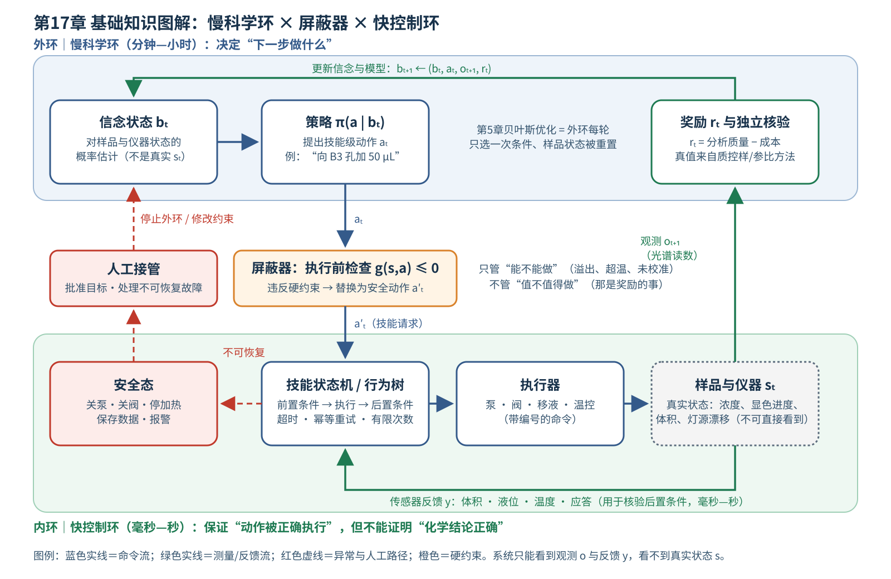
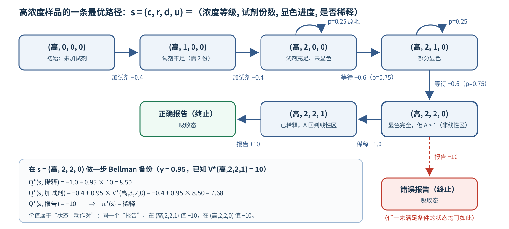

# 第17章 实验决策、强化学习与具身自主实验室

> 第5篇 科学智能体与自主分析系统

## 章首导引

第5章讨论了“下一个实验做哪一个点”：贝叶斯优化在每一轮给出一个候选条件，实验做完、数据回来、模型更新，再选下一个点。那里每一次实验彼此独立，选错一个点的代价只是浪费一次测量。

真实的自动化分析却常常不是这样。往比色孔里加了显色剂就收不回来；等待显色的每一分钟都占用仪器；高浓度样品不稀释就会落到吸光度非线性区；移液枪吸进气泡时，后面所有步骤都在错误体积上进行。**此时的决策对象不再是“一个实验条件”，而是“一串依赖当前状态的操作”**——今天的动作改变明天可以做什么、能看到什么、最终结果是否可信。

本章要回答一个核心问题：

> **什么情况下实验问题是连续决策，而不是一次性优化？一旦是连续决策，怎样把它写成状态—动作—奖励模型，并让它在真实仪器的安全约束下运行？**

全章以一个可以在教学实验室搭建的低成本“移液—显色—光谱”工作站为主线：用铁(II)–邻二氮菲显色法（510 nm）测定样品铁含量。我们先判断问题类型（17.1），再写出 MDP（17.2）和奖励（17.3），然后讨论为什么不能在真实仪器上随意试错（17.4），接着下沉到执行层的技能、状态机和故障恢复（17.5）以及快慢两个时间尺度（17.6），最后把这些组装为一个可验收的综合案例（17.7）。

**与相邻章节的边界**：第5章负责“单步选点”（实验设计、贝叶斯优化、主动学习）；第16章负责“语言模型怎样调用工具”；第18章负责“预测操作—样品—信号的动态模型”。本章只处理**多步、带物理后果的实验决策与执行**。

## 学习目标

完成本章后，你应能：

1. 用四条判据（状态延续、不可逆、延迟后果、动作改变可观测信息）判断一个实验问题应当用批量设计、序贯选点还是序贯控制来处理，并说明理由。
2. 为一个具体的分析流程写出 MDP 五元组 $(\mathcal S,\mathcal A,P,R,\gamma)$，检查状态是否满足马尔可夫性，并能手算一步 Bellman 备份。
3. 把分析化学指标（准确度、检测限、信噪比、分离度、时间与试剂消耗）写成奖励或约束，识别至少两种奖励投机方式。
4. 区分“奖励表达的科学目标”和“屏蔽器表达的硬安全约束”，说明离线学习与仿真训练各自的风险。
5. 用前置/后置条件描述实验技能，设计含超时、幂等重试和安全态的有限状态机，并用故障注入检验它是否会产生“静默错误”。
6. 为一个自主实验平台给出完整的评价指标：有效结果数、静默错误率、人工接管间隔、吞吐和与人工对照的复现性。

## 互动案例：自主显色工作站的第一次夜间值班

你负责让实验室的移液—显色—光谱工作站第一次在无人值守的夜间自主运行。在按下“开始”之前，你要做出三项决定：怎样定义状态、用什么作为奖励、遇到故障时系统应如何反应。每个决定都对应本章的一节；完成后再回答一道迁移题。

<section class="interactive-lab" data-lab="ch17-autonomy-shift"></section>

## 本章基础知识图解：双环自主实验系统



**怎样读这张图。** 图中有两个嵌套的闭环。

- **外环（慢科学环，分钟—小时）**：策略 $\pi$ 根据信念状态 $b_t$（对样品与仪器状态的估计）提出一个**技能级动作** $a_t$，例如“向 B3 孔加 50 µL 显色剂”。测量结果形成观测 $o_{t+1}$，用来计算奖励 $r_t$ 并更新信念与模型。第5章的贝叶斯优化只是外环的一种特例：它每轮只做一次选点，不考虑动作对后续状态的影响。
- **内环（快控制环，毫秒—秒）**：技能状态机把 $a_t$ 分解为泵、阀、移液和光谱仪命令，用传感器反馈 $y$ 检查每一步的后置条件，必要时重试或恢复。
- **屏蔽器（shield）**位于两环之间：它不评价动作在科学上“好不好”，只拦截违反硬约束 $g(s,a)\le 0$ 的动作（如溢出、超温、未校准即读数），并给出替代的安全动作 $a'_t$。
- **故障路径（虚线）**：任何不可恢复的异常都进入**安全态**，再由人工接管；人也可以随时停止外环。

图的边界条件：外环只能看到观测 $o$，看不到真实状态 $s$（部分可观测）；内环的成功只说明“动作被执行了”，不说明“化学上是正确的”——后者要靠质控样和参比测量回到外环检验。

## 17.1 一次性优化还是连续决策？

### 17.1.1 三类实验决策问题

| 类型 | 每次决定什么 | 动作之间的关系 | 典型方法 | 分析化学例子 |
|---|---|---|---|---|
| 批量设计 | 一次性给出全部实验条件 | 彼此独立，事先确定 | 析因/响应面设计（第5章） | 色谱方法开发中的 Box–Behnken 设计 |
| 序贯选点 | 下一个实验条件 $x_{k+1}$ | 只通过“模型知识”相互影响；样品和仪器每次都从同一初始状态开始 | 贝叶斯优化、主动学习、多臂老虎机 | 逐轮选择 pH 与显色剂浓度以提高灵敏度 |
| 序贯控制 | 当前状态下的下一个**操作** $a_t$ | 动作改变物理状态，从而改变以后可行的动作和可得的观测 | MDP/POMDP、强化学习、模型预测控制、规划 | 一个样品的加试剂—等待—稀释—读数流程；多步纳米颗粒包覆 |

序贯选点与序贯控制都“一步一步做”，区别不在于步数，而在于**样品与仪器的状态是否在步骤之间延续**。贝叶斯优化中每个实验都从一个新的样品开始，模型的知识在积累，但物理状态被重置；序贯控制中，同一个样品（或同一台仪器）的状态被连续改变。

### 17.1.2 四条判据

当以下条件中出现一条或多条时，应考虑把问题写成序贯控制问题：

1. **状态延续**：前一动作的结果留在系统里（加入的试剂、经过的时间、柱温、电极表面状态）。
2. **不可逆**：动作无法撤销（加入过量试剂、稀释、消耗唯一样品、电极钝化）。
3. **延迟后果**：动作的好坏要过几步才能看出（显色是否完全只有等到读数稳定才知道）。
4. **动作改变可观测信息**：是否测量、何时测量、用哪种手段测量，会决定后续能看到什么（例如先做快速预读才知道是否需要稀释）。

反过来，若每次实验都可以独立重复、动作没有长期后果、只关心找到最好的一组条件，那么用贝叶斯优化或实验设计就足够了，强行使用强化学习只会增加样本需求和风险。**选择更简单的问题形式本身就是一项专业判断。**

### 17.1.3 自动化与自主化

自动化是“按预先写好的流程执行”；自主化是“依据观测改变下一步做什么”。两者之间可以粗分为几个层级：固定脚本 → 带异常处理的脚本 → 由算法选择下一轮实验条件（序贯选点） → 由算法在样品层面选择操作序列（序贯控制） → 由系统自己提出假设与实验目标。文献中常借用自动驾驶的分级思路讨论自主实验室的层级（参见 Tom 等 2024 年综述）。分级的意义不在于“越高越先进”，而在于明确：**每上升一级，系统就多承担一种原本由人承担的判断，也就多需要一种验证手段。**

### 本节互动：判断问题类型

<section class="interactive-lab" data-lab="ch17-problem-sorter"></section>

## 17.2 把实验写成马尔可夫决策过程

### 17.2.1 五元组与显色案例

马尔可夫决策过程（MDP）记作 $(\mathcal S,\mathcal A,P,R,\gamma)$。以单个比色样品为例（对应练习 `01_colorimetric_mdp.py`）：

| 元素 | 含义 | 显色案例中的写法 |
|---|---|---|
| 状态 $s\in\mathcal S$ | 决策所需的全部当前信息 | $s=(c,r,d,u)$：浓度等级 $c$、已加显色剂份数 $r$、显色进度 $d\in\{0,1,2\}$、是否已稀释 $u$ |
| 动作 $a\in\mathcal A$ | 当前可执行的技能级操作 | 加试剂、等待、稀释、读数报告 |
| 转移 $P(s'\mid s,a)$ | 动作后状态的概率分布 | 试剂充足时，每次等待以概率 0.75 使显色推进一级；试剂不足时最多“部分显色” |
| 奖励 $R(s,a)$ | 即时收益或代价 | 加试剂 −0.4、等待 −0.6、稀释 −1.0；报告正确 +10，报告错误 −10 |
| 折扣 $\gamma$ | 未来收益的权重 | 0.95 |

策略 $\pi(a\mid s)$ 给出在每个状态下选择动作的规则。目标是最大化期望折扣回报 $G_t=\sum_{k\ge 0}\gamma^k r_{t+k}$。



上图把高浓度样品的一条成功路径画成状态转移图：每个方框是一个状态，箭头上标注动作与即时奖励；“报告”从任何非目标状态出发都会进入“错误报告”吸收态。读图时注意，**同一个动作“报告”在不同状态下的价值相差 20 分**——价值属于“状态—动作对”，而不属于动作本身。

### 17.2.2 马尔可夫性是对状态设计的要求

马尔可夫性要求：给定当前状态与动作，未来与过去无关，即 $P(s_{t+1}\mid s_t,a_t)=P(s_{t+1}\mid s_0,a_0,\dots,s_t,a_t)$。这不是自然界自动满足的性质，而是**对状态定义的要求**。

如果状态只记录“当前吸光度”，那么同样读到 $A=0.35$ 的两个孔，一个刚加完试剂、一个已经显色 20 分钟，未来的变化完全不同——状态缺少了“自加试剂以来的时间”。补上这一变量（或等价的显色进度 $d$），过程才重新成为马尔可夫的。实践中检查状态是否充分的办法是：**找两条历史不同、但状态相同的轨迹，看它们的后续统计是否一致。** 不一致就说明漏掉了变量（温度、批次、枪头使用次数、灯源点亮时长都是常见遗漏）。

状态也不能无限扩张：变量越多，需要的数据越多。好的状态是“对未来决策有影响”的最小充分集合。

### 17.2.3 价值函数与 Bellman 方程

状态—动作价值函数 $Q^\pi(s,a)$ 表示在 $s$ 执行 $a$、之后按 $\pi$ 行动的期望回报。最优价值满足 Bellman 最优方程：

$$Q^*(s,a)=\sum_{s'}P(s'\mid s,a)\left[R(s,a,s')+\gamma\max_{a'}Q^*(s',a')\right]$$

**手算一步。** 考虑高浓度样品，已加 2 份试剂、显色完全、未稀释：$s=(\text{高},2,2,0)$。已知稀释后再报告必然正确，$V^*(\text{高},2,2,1)=10$。于是

$$Q^*(s,\text{稀释})=-1.0+0.95\times 10=8.50,\qquad Q^*(s,\text{报告})=-10$$

再看“加试剂”：它把状态变为 $(\text{高},3,2,0)$，那里最好的选择仍是稀释，价值 $-1.0+0.95\times10=8.50$，所以 $Q^*(s,\text{加试剂})=-0.4+0.95\times8.50=7.675$。三个数与练习 1 的输出一致。可以看到，**值迭代就是把这种一步计算在所有状态上反复做到不再变化。**

练习 1 还把最优闭环策略和“一次性优化”的固定流程作比较：最好的固定流程必须为“最坏的样品 + 最慢的显色”预留试剂和等待时间（加 2 份、等 4 步、总是稀释），期望回报约 2.8；闭环策略根据浓度等级和显色进度决定是否继续等待、是否稀释，期望回报约 5.5，报告正确率也更高。**闭环的价值来自“看了再做”，而不是来自更复杂的算法。**

### 17.2.4 部分可观测：从状态到信念

真实系统中，样品的浓度、显色是否完全、灯源是否漂移都不能直接看到，只能通过观测 $o_t$ 推断。这样的问题是部分可观测 MDP（POMDP）。决策应基于**信念状态** $b_t(s)=P(s_t=s\mid o_{1:t},a_{0:t-1})$，其更新为

$$b_{t+1}(s')\propto P(o_{t+1}\mid s')\sum_s P(s'\mid s,a_t)\,b_t(s)$$

在分析化学中，这就是“用测量更新对样品状态的认识”。它带来一个重要结论：**测量本身是一种动作**，它消耗时间和样品，但减少不确定度。何时测量、测几次，应当和加试剂、稀释一起进入决策。练习 2 用“最近读数分箱 + 读数趋势 + 动作计数”的有限记忆观测近似信念状态，这是表格方法处理 POMDP 的常见折中。

### 17.2.5 终止、失败与吸收态

每个实验回合都要有明确的终止条件：报告结果、达到步数或时间上限、进入安全态。失败也应写成状态（例如“已溢出”“已弃样”），并设为吸收态，否则算法会把失败后的“继续操作”当作正常可能性来估值。终止奖励必须与分析目标一致：如果“超时终止”的惩罚比“错误报告”还重，系统就会倾向于在不确定时仓促报告。

### 本节互动：为显色孔设计状态

<section class="interactive-lab" data-lab="ch17-state-designer"></section>

## 17.3 奖励函数：把分析目标写成可优化的数

### 17.3.1 从分析指标到奖励

强化学习只优化你写下的奖励。对分析实验而言，奖励应当来自分析质量指标，而不是“看起来像成功”的代理量。

| 分析目标 | 可用的奖励或约束形式 | 需要的参照 |
|---|---|---|
| 准确度 | $-\lvert\hat c-c_{\text{ref}}\rvert/c_{\text{ref}}$ | 标准物质或参比方法 |
| 精密度 | $-s_{\hat c}$（重复测定标准差） | 平行测定 |
| 检测能力 | 满足 $\text{LOD}\le$ 目标值的约束 | 空白重复测量 |
| 信号质量 | SNR 达到阈值，且吸光度处于线性区（如 $0.1<A<1.0$） | 校准曲线与线性范围 |
| 分离 | 关键峰对分离度 $R_s\ge1.5$ | 色谱峰表 |
| 信息获取 | 预期信息增益（后验熵减少） | 概率模型 |
| 资源 | $-\lambda_t t-\lambda_v V_{\text{试剂}}-\lambda_s V_{\text{样品}}$ | 计时与耗材记录 |

### 17.3.2 加权和、约束与帕累托

多目标最常见的写法是加权和 $r=\sum_k w_k f_k$。它简单，但权重的单位换算往往没有依据（1 分钟时间值多少百分点误差？）。另外两种写法通常更可解释：

- **约束形式**：把必须满足的质量要求写成约束，只优化剩下的目标，例如“在相对误差 ≤ 5% 且 $A<1.0$ 的前提下，最小化时间”。这对应约束 MDP。
- **帕累托形式**：报告一组互不支配的策略，让使用者在精度与通量之间选择（参见第5章多目标优化）。

经验法则：**安全与合规写成约束，质量门槛写成约束或大惩罚，真正需要权衡的资源才写进加权和。**

### 17.3.3 奖励投机

奖励投机（reward hacking）是指智能体找到了提高奖励、却违背设计者本意的行为。在分析实验中尤其常见：

- **以信号强度为奖励**：练习 2 中，奖励为“报告时的吸光度”的智能体学会只加 1 份显色剂、尽快报告，高浓度样品络合不完全，浓度误差约 30%；它从未稀释，也不关心是否落在线性区。
- **以“完成测量数”为奖励**：系统跳过空白、跳过平衡，吞吐很高，数据不可用。
- **以模型不确定度下降为奖励**：系统反复测量同一个容易的样品，熵下降很快，却没有覆盖需要的浓度范围。
- **以仪器读数与预测一致为奖励**：系统学会选择让读数饱和的条件，因为饱和读数“总是一样”。

防范方法：奖励直接对准分析结果（浓度、分离度）而非中间信号；对关键约束使用屏蔽器或硬约束；定期用盲样和标准物质检查；查看策略实际做了什么，而不只看奖励曲线。

### 17.3.4 奖励需要“真值”从哪里来

在仿真器中我们知道样品真实浓度，因此可以计算误差奖励。真实实验室没有真值，奖励只能由**参照测量**近似：插入已知浓度的质控样、使用标准加入法、与参比方法定期比对。奖励的不确定度会传递给策略：参照方法的重复性为 2%，就不应期待策略学会区分 1% 的差别。这一点与第2章“参照值也是一次测量”完全一致。

### 本节互动：调节奖励权重，观察策略怎样变化

<section class="interactive-lab" data-lab="ch17-reward-tuner"></section>

## 17.4 安全探索：约束、屏蔽器、离线学习与仿真

### 17.4.1 为什么不能在真实仪器上随意试错

强化学习依赖探索：为了知道某个动作不好，常常需要真的做一次。在游戏中这没有代价；在实验室中，一次溢出可能污染仪器、一次过压可能损坏色谱柱、一次错误混合可能产生有害气体。练习 2 中，奖励设计正确但没有安全约束的智能体在 60000 个训练回合中造成了数千次“溢出”——在仿真中这只是一个计数器，在真实平台上是不可接受的。

### 17.4.2 约束 MDP 与屏蔽器

约束 MDP 在最大化回报的同时要求累计代价不超过上限：

$$\max_\pi\ \mathbb E_\pi\Big[\sum_t\gamma^t r_t\Big]\quad\text{s.t.}\quad \mathbb E_\pi\Big[\sum_t\gamma^t c_t\Big]\le C_{\max}$$

这种“期望约束”允许偶尔违反，适合软约束（如试剂预算）。对于**一次都不能违反**的硬约束（溢出、超温、超压、未校准就报告），更可靠的是**屏蔽器**：在动作执行之前，用一个可验证的规则或模型检查 $g(s,a)\le0$，不满足就替换为安全动作。屏蔽器的要点：

1. 它只编码硬约束，不替代科学目标；
2. 它的规则必须可审查、可测试，最好比策略简单得多；
3. 它需要的状态量（当前体积、温度、压力）必须由可靠传感器提供——屏蔽器的可靠性不会高于其传感器。

练习 2 的设置 C 中，屏蔽器拦截“会使孔内体积超过 400 µL 的加液或稀释”，训练期溢出降为 0，最终精度接近未加屏蔽的设置 B。代价是部分高收益路径被挡住，最高浓度样品的误差略大——**安全约束有代价，应当把这个代价量化并报告。**

### 17.4.3 离线强化学习

离线强化学习只使用已经记录的历史数据（例如过去几年的仪器日志）学习策略，不再与环境交互。它避免了在线试错，但面临**分布偏移**：策略倾向于选择历史数据中很少出现的动作，而那些动作的价值估计恰恰最不可靠。常用对策是让新策略不偏离记录策略太远（保守 Q 学习、行为约束），并只在数据覆盖充分的区域部署。分析化学中的历史数据往往只记录了“成功的流程”，失败和中止很少保存——**没有记录失败的日志无法教会系统避免失败**，这是数据管理（第14章）和本章的直接连接点。

### 17.4.4 仿真训练与分阶段放权

仿真器可以安全地产生大量经验，但仿真与真实之间存在差距（sim-to-real gap）：真实的显色速率随温度变化、真实的移液误差有偏差、真实的杂散光与仿真不同。缓解手段包括：

- **域随机化**：训练时随机化仿真参数（显色速率、移液误差、噪声水平），让策略对不确定参数稳健；
- **离策略评估**：上线前用历史数据估计新策略的表现，不直接在真实系统上试；
- **分阶段放权**：先“只建议不执行”（人工确认每一步），再“执行但人可否决”，最后才“无人值守”，每一阶段都设定明确的退出指标。

### 17.4.5 人工接管与停止条件

停止条件应在运行之前写好，而不是出事后补：例如连续 3 次质控失败、同一故障在 1 小时内重复出现、观测超出训练分布（适用域外，参见第15章）、策略在同一状态循环超过 N 步。人工接管后要记录原因，这些记录是下一版状态设计和屏蔽规则的主要来源。

### 本节互动：给策略装上屏蔽器

<section class="interactive-lab" data-lab="ch17-shield-lab"></section>

## 17.5 具身执行层：技能、状态机与故障恢复

### 17.5.1 硬件与接口

一个最小的移液—显色—光谱工作站通常包括：移液单元（注射泵或开源移液机器人）、孔板或比色皿、恒温模块、光源与光谱仪（或 LED—光电二极管比色计），以及一台运行控制程序的计算机。仪器之间的通信可以是串口/USB 命令、厂商 SDK，也可以采用实验室自动化标准，例如 [SiLA 2](https://sila-standard.com/) 或基于 [OPC UA](https://opcfoundation.org/about/opc-technologies/opc-ua/) 的设备接口。无论哪种方式，都应满足三点：每条命令有唯一编号；每个响应带时间戳；仪器状态可以被查询而不只是被设置。没有统一时钟的系统无法把“何时加的试剂”和“何时读的数”对上，状态中的“显色时间”就无从计算。

### 17.5.2 技能：前置条件与后置条件

强化学习的动作不应直接是“泵转 200 步”，而应是**技能**：一个有明确语义、可以被检查的操作单元。每个技能写成

| 技能 | 前置条件（执行前必须成立） | 后置条件（执行后必须验证） | 失败时 |
|---|---|---|---|
| 取枪头 | 枪头盒有余量；移液头空 | 枪头检测传感器为真 | 换位重试 ≤2 次 → 请人补充 |
| 分液 50 µL | 有枪头；目标孔剩余容量 ≥ 50 µL | 体积传感器/称量显示 50 ± 2.5 µL | 只补差额 → 仍失败则弃样 |
| 等待显色 | 已加足试剂 | 计时完成；（可选）读数变化 < 2% | 延长等待 ≤1 次 |
| 测量 | 已做空白；灯源预热 | 返回读数且在 0–2.0 之间 | 重连 ≤2 次 → 安全态 |
| 质控 | 参比溶液在位 | 参比读数偏差 ≤ 3% | 重新校准后重测 |

**后置条件是自主系统“知道自己做对了”的唯一途径。** 没有后置条件检查的自动化，只是把错误执行得更快。

### 17.5.3 有限状态机与行为树

有限状态机（FSM）把流程写成状态和带条件的转移：`取枪头 → 分液 → 体积核验 → 等待显色 → 测量 → 质控 → 完成`，每个状态都有一条通往“恢复”或“安全态”的出口。FSM 的优点是可穷举、易于验证：可以列出所有状态与转移，检查是否存在死循环或无法到达安全态的分支。

行为树把技能组织成树：顺序节点（依次执行，任一失败即失败）、选择节点（依次尝试，任一成功即成功）和条件节点。它适合表达“先尝试 A，失败则尝试 B，再失败则进入安全态”这样的恢复逻辑，也便于在不改动其他部分的情况下插入新技能。两者可以结合：高层用行为树组合技能，每个技能内部用小的 FSM 管理硬件细节。

### 17.5.4 幂等、超时、重试与安全态

- **超时**：每个硬件命令都要有超时；“没有回应”不等于“没有执行”。
- **幂等**：重复执行同一命令与执行一次效果相同。练习 3 中，“分液 50 µL”的确认帧丢失后，朴素控制器换新编号重发，泵实际分液两次；幂等设计则把命令写成“使孔内体积达到 50 µL”，重试前先查询泵计数器或体积传感器，只补差额。
- **有限重试**：重试次数有上限，超过就升级处理，避免在故障上无限循环。
- **安全态**：一个在任何时候都能进入、进入后不会造成进一步危害的状态——关泵、关阀、停止加热、保存数据、报警。安全态不是“程序退出”，而是被明确设计和测试过的状态。

### 17.5.5 最危险的不是停机，而是静默错误

练习 3 向工作站注入了 7 类故障（气泡吸液不足、应答丢失、通信超时、灯源漂移、枪头缺失、漏液、显色剂分装失效）。只发命令、不核验的朴素控制器“从不停机”，平均连续自治样品数更高，却有约三分之一的结果是**没有报警的错误结果**；带后置条件核验、幂等补液和参比质控的控制器把绝大多数故障转成了可恢复事件，静默错误降到约 1%。剩下的那部分来自“显色剂分装失效”——体积和参比都正常，现有传感器看不见它。

由此得到两条原则：**自治时长必须和静默错误率一起报告；能检测哪些故障，取决于放置了哪些传感器和质控样。** 故障注入的目的，正是在上线之前把“看不见的故障”找出来。

### 本节互动：故障注入演练

<section class="interactive-lab" data-lab="ch17-fault-injection"></section>

## 17.6 双时间尺度：快控制环、慢科学环与人

### 17.6.1 不同决策属于不同时间尺度

| 时间尺度 | 决策例子 | 应由谁负责 |
|---|---|---|
| 毫秒—秒 | 泵速闭环、液位检测、急停 | 嵌入式控制器与硬件联锁 |
| 秒—分钟 | 技能执行、重试、超时、质控判定 | 技能状态机 / 行为树 |
| 分钟—小时 | 选择下一个样品的操作序列、下一轮实验条件 | 强化学习策略或贝叶斯优化 |
| 天—周 | 修改目标、更换方法、批准扩大自主权限 | 人 |

把慢决策放进快环（例如让大模型或强化学习直接控制泵速）会带来不可接受的延迟和不可预测性；把快决策放进慢环（例如等科学模型判断是否该急停）同样危险。**急停与联锁必须在硬件层实现，不能依赖任何学习模型。**

### 17.6.2 分层：上层只发技能级请求

分层结构的接口是技能：上层策略只能请求“对 B3 孔执行稀释”，不能直接写电机命令；下层执行器负责把它变成安全的硬件操作，并返回“成功/失败/原因”。这样做的好处是：上层的学习不会绕过下层的安全检查；下层可以独立测试；更换硬件时上层策略不必重训。

### 17.6.3 异步测量与资源调度

显色需要等待，光谱仪却可以同时为其他样品服务。真实平台总是多个样品并行、共享仪器，因此还要解决调度问题：哪个样品先测、仪器空闲时做什么。调度器要保证“动作的时间戳”与“观测的时间戳”对应，否则状态中的显色时间就是错的。一个常见错误是用“命令发出时间”代替“命令完成时间”。

### 17.6.4 人在环中的位置

人不应该是“出了问题才被叫醒的人”，而应当在设计中被分配明确职责：批准目标与约束、审核屏蔽规则、处理不可恢复故障、定期审查系统选出的实验和结果。最近关于自主实验室安全的讨论（见本章前沿更新卡三）也强调，安全需要在系统设计阶段就被纳入，而不是事后附加。

### 本节互动：把决策分配到正确的环

<section class="interactive-lab" data-lab="ch17-loop-assigner"></section>

## 17.7 综合案例：低成本移液—显色—光谱平台

### 17.7.1 化学与平台

铁(II)与邻二氮菲在 pH 约 3–9 形成稳定的橙红色络合物，最大吸收约 510 nm，摩尔吸光系数约 $1.1\times10^4\ \text{L·mol}^{-1}\text{·cm}^{-1}$；样品中的 Fe(III) 需先用盐酸羟胺还原（参见 ISO 6332 水质铁测定方法）。以 1 cm 光程计，1 mg/L 铁约对应 $A\approx0.20$，因此约 5 mg/L 以上的样品就会超过常用线性区 $A<1.0$，需要稀释。还原与络合需要一定时间，显色进度依赖试剂过量程度和温度——这正是本章所需的“状态延续、不可逆、延迟后果”。

平台可以用开源移液机器人或注射泵、96 孔板、LED 光源与小型光谱仪（或板式读数仪）搭建；教学中也可先完全使用练习代码中的仿真器。

### 17.7.2 问题卡

| 项目 | 内容 |
|---|---|
| 分析目标 | 在相对误差 ≤ 5% 的前提下，尽量缩短每个样品的时间和试剂消耗 |
| 状态 | 已加试剂量、自加试剂以来的时间、稀释倍数、最近两次读数、孔内体积、灯源最近一次质控结果 |
| 动作 | 加试剂（25/50 µL）、等待（1 min）、稀释、测量、报告、弃样 |
| 奖励 | 报告时 $10-40\times$ 相对误差（以质控样标定）；每步扣除时间与试剂成本 |
| 硬约束（屏蔽器） | 孔内体积 ≤ 400 µL；未做空白不得测量；读数 > 1.5 不得报告 |
| 停止条件 | 连续 3 次质控失败；漏液报警；同一状态循环 > 10 步 |

### 17.7.3 实验方案与对照

1. **基线一：固定流程**——按标准方法加足试剂、等待 15 min、全部 10 倍稀释后读数。
2. **基线二：人工操作**——同一批盲样由学生手工完成，记录时间与误差。
3. **序贯选点**——用贝叶斯优化离线确定一组最佳“固定流程参数”（第5章方法）。
4. **闭环策略**——在仿真器中训练，经域随机化和屏蔽器后，以“只建议、人工确认”的模式上线，再逐步放权。

四种方案使用同一批盲样（覆盖 0.5–12 mg/L，包含质控样），按浓度区间分层报告误差，而不只报告平均值。

### 17.7.4 故障注入测试矩阵

| 注入的故障 | 注入方式 | 期望行为 | 检验依据 |
|---|---|---|---|
| 气泡 | 故意吸入少量空气 | 体积核验失败 → 补差额 | 体积日志 |
| 通信中断 | 运行中拔掉光谱仪 USB | 超时 → 重连 → 失败则安全态 | 状态机日志 |
| 灯源漂移 | 用中性滤光片部分遮挡 | 参比偏差超限 → 重新校准 | 质控记录 |
| 耗材耗尽 | 移走枪头盒 | 有限重试 → 请人补充 | 接管记录 |
| 漏液 | 在液位传感器处滴水 | 立即进入安全态 | 急停响应时间 |
| 应答丢失 | 在软件中丢弃确认帧 | 查询后补液，不重复分液 | 体积日志 |

### 17.7.5 评价指标

一个自主实验平台的报告至少应包括：有效结果数与**静默错误率**（用盲样检出）、人工接管次数与平均间隔、每小时样品数、每个样品的试剂和样品消耗、与人工操作的误差对比和复现率（同一样品不同日期重复）。只报告“自主运行了 X 小时”是不够的。

## 前沿更新卡（2026–2027 学年）

> **前沿更新卡一：用强化学习发现多步化学路线——AlphaFlow（2023）**
>
> - **来源**：Volk, A. A. *et al.* [AlphaFlow: autonomous discovery and optimization of multi-step chemistry using a self-driven fluidic lab guided by reinforcement learning](https://doi.org/10.1038/s41467-023-37139-y). *Nature Communications* **14**, 1403 (2023)。证据等级：同行评审原始研究。
> - **新在哪里**：此前的自主实验多以贝叶斯优化选择“一组条件”；AlphaFlow 把核—壳半导体纳米颗粒的壳层生长（受胶体原子层沉积 cALD 启发）写成**步骤顺序可变**的多步决策问题，用强化学习在微液滴反应器中结合在线光谱监测进行探索，所发现的多步路线（最多约 40 个参数）优于常规序列。
> - **与本章的关系**：它正是 17.1 判据所描述的情形——每一步注入的前驱体都会改变颗粒状态，后续步骤的效果取决于前面做了什么，奖励（光学性质）要在多步之后才能评估。
> - **仍受什么限制**：结论建立在单一微流控平台和单一化学体系的自产数据上；奖励依赖在线光谱这一种表征，换体系或换平台需要重新学习；学到的策略本身不直接给出化学机理解释。

> **前沿更新卡二：“自主完成”不等于“结果正确”——A-Lab 及其再分析（2023—2024）**
>
> - **来源**：Szymanski, N. J. *et al.* [An autonomous laboratory for the accelerated synthesis of inorganic materials](https://doi.org/10.1038/s41586-023-06734-w). *Nature* **624**, 86–91 (2023)；Leeman, J. *et al.* [Challenges in high-throughput inorganic materials prediction and autonomous synthesis](https://doi.org/10.1103/PRXEnergy.3.011002). *PRX Energy* **3**, 011002 (2024)。证据等级：均为同行评审文献，二者结论存在争议。
> - **新在哪里**：A-Lab 在 17 天连续运行中，用文献训练的模型提出配方、用主动学习修正，并以机器人完成固体合成与 X 射线衍射表征，报告由 57 个目标得到 36 个化合物。
> - **争议与教训**：Leeman 等对产物逐一复核，指出自动化 Rietveld 精修尚不可靠、预测中常忽略成分无序，认为相当部分“新材料”很可能是已知的无序相。这与 17.5.5 的“静默错误”同构：**闭环跑通了，但判定成功的那一步（表征解释）本身没有被验证。**
> - **对本章的要求**：自主系统的“奖励/成功判定”必须有独立的复核路径（盲样、参比方法、人工抽检），并在报告中区分“系统判定成功”和“独立验证成功”。

> **前沿更新卡三：把安全前置到自主实验室设计中（2025）**
>
> - **来源**：Leong, S. X. *et al.* [Steering towards safe self-driving laboratories](https://doi.org/10.1038/s41570-025-00747-x). *Nature Reviews Chemistry* **9**, 707–722 (2025)。证据等级：观点/综述性文章，非原始实验结果。
> - **要点**：作者把自主实验室的发展与其他自主技术（如自动驾驶）对照，指出随着自主实验室可执行的化学过程范围扩大，必须把安全放在研究前沿，以防范从“险兆事件”到严重事故的各类风险，并讨论了当前安全现状与社区可采取的行动。
> - **与本章的关系**：对应 17.4 的屏蔽器与停止条件、17.6 的分层与人工职责。本章的立场是：安全约束应由可审查的规则和硬件联锁实现，而不是期望学习算法“学会安全”。
> - **仍受什么限制**：这是观点性文章，提出的框架尚缺少统一的量化评价标准；具体到分析实验室，各类故障的发生率和后果仍需各平台自行积累数据。

延伸阅读：Dai, T. *et al.* [Autonomous mobile robots for exploratory synthetic chemistry](https://doi.org/10.1038/s41586-024-08173-7). *Nature* **635**, 890–897 (2024)——其决策器是基于正交表征（LC–MS 与台式 NMR）的启发式规则而不是强化学习，适合与本章对照讨论“何时不需要强化学习”。

## 关键关系与计算抓手

- MDP 五元组：$(\mathcal S,\mathcal A,P,R,\gamma)$；回报 $G_t=\sum_{k\ge0}\gamma^k r_{t+k}$
- Bellman 最优方程：$Q^*(s,a)=\sum_{s'}P(s'\mid s,a)\,[R+\gamma\max_{a'}Q^*(s',a')]$
- Q-learning 更新：$Q(s,a)\leftarrow Q(s,a)+\alpha\,[r+\gamma\max_{a'}Q(s',a')-Q(s,a)]$
- 信念更新：$b_{t+1}(s')\propto P(o_{t+1}\mid s')\sum_s P(s'\mid s,a_t)b_t(s)$
- 约束 MDP：$\max_\pi \mathbb E[\sum\gamma^t r_t]$ s.t. $\mathbb E[\sum\gamma^t c_t]\le C_{\max}$；屏蔽器：执行前检查 $g(s,a)\le0$
- 朗伯—比尔定律与线性区：$A=\varepsilon bc$，常用 $0.1<A<1.0$

## 常见误区

| 误区 | 为什么不对 |
|---|---|
| “多步实验就要用强化学习” | 若各步之间没有状态延续，贝叶斯优化或实验设计更省数据、更易解释 |
| “奖励就是测到的信号越强越好” | 信号强度是代理量，会诱导饱和、过量试剂等奖励投机 |
| “让强化学习自己学会不溢出” | 学会的前提是真的溢出过；硬约束应由屏蔽器和硬件联锁保证 |
| “系统跑了 48 小时没停机，说明很可靠” | 不检查后置条件的系统也不会停机；必须同时报告静默错误率 |
| “仿真中表现好，上线就能用” | 仿真参数与真实存在差距，需要域随机化、离策略评估和分阶段放权 |

## 代码实践

所有练习只依赖 `numpy`，从仓库根目录运行：

```bash
python code/ch17.py            # 依次运行三个练习（约 30 s）
python code/ch17.py 1          # 只运行练习 1
```

| 文件 | 内容 | 观察要点 |
|---|---|---|
| [01_colorimetric_mdp.py](../code/ch17_exercises/01_colorimetric_mdp.py) | 显色样品 MDP、值迭代、闭环 vs 开环、$\gamma$ 与错误惩罚的影响 | 同一“报告”动作在不同状态下的 Q 值；惩罚为 0 且 $\gamma=0.6$ 时策略变为“直接报告” |
| [02_reward_and_shield.py](../code/ch17_exercises/02_reward_and_shield.py) | 部分可观测仿真器、Q-learning、信号奖励 vs 误差奖励、安全屏蔽器 | 信号奖励导致的奖励投机；训练期溢出次数；屏蔽器对精度的代价 |
| [03_fsm_fault_injection.py](../code/ch17_exercises/03_fsm_fault_injection.py) | 技能状态机、7 类故障注入、朴素 vs 稳健控制器 | 静默错误；自治时长为什么会“误导”；哪些故障仍不可见 |

建议的扩展：把练习 2 的仿真参数（显色速率、移液误差）随机化后重新训练，再在固定参数的仿真器上测试，体会域随机化的作用；在练习 3 中加入一种新的传感器，使“显色剂分装失效”变得可检测。

## 本章小结

1. 实验问题是否需要连续决策，取决于状态是否在步骤间延续、动作是否不可逆、后果是否延迟、动作是否改变可观测信息；不满足时应优先使用更简单的实验设计或序贯选点。
2. MDP 的关键在状态设计：马尔可夫性是对状态定义的要求。真实系统是部分可观测的，测量本身是一种需要付出代价的动作。
3. 奖励应对准分析结果而非代理信号；安全和质量门槛优先写成约束。奖励需要的“真值”来自标准物质和参比方法，其不确定度限制了策略能学到的精度。
4. 硬约束由屏蔽器和硬件联锁保证，科学目标由奖励表达；离线学习受分布偏移限制，仿真训练受 sim-to-real 差距限制，应分阶段放权。
5. 执行层以技能为单位，用前置/后置条件、超时、幂等重试和安全态组织；故障注入的首要目标是暴露静默错误。
6. 自主实验平台的评价必须同时包含有效结果、静默错误率、人工接管间隔、吞吐和与人工对照的复现性。

## 思考题与计算题

1. **（判断）** 下列问题分别属于批量设计、序贯选点还是序贯控制？说明依据的判据：(a) 选择 HPLC 流动相比例与柱温以最大化分离度；(b) 电化学传感器在连续测量中决定何时清洗电极；(c) 在线监测反应时决定何时取样、何时终止反应。
2. **（计算）** 在 17.2.3 的例子中，若稀释的成本由 −1.0 改为 −3.0，$Q^*((\text{高},2,2,0),\text{稀释})$ 为多少？最优动作是否改变？若改为 −12 呢？
3. **（计算）** 设状态 $(\text{高},2,1,0)$ 下“等待”以概率 0.75 进入 $(\text{高},2,2,0)$（价值 8.50），否则停留原状态。写出 $V^*$ 满足的方程（假设最优动作就是等待），并求解 $V^*(\text{高},2,1,0)$。
4. **（建模）** 为“自动滴定终点判断”写出状态、动作、奖励和至少两条硬约束，并说明状态中哪个变量最容易被遗漏而破坏马尔可夫性。
5. **（奖励）** 给出一种在色谱方法开发中可能出现的奖励投机，并修改奖励或约束来防止它。
6. **（安全）** 练习 2 中，屏蔽器使最高浓度样品误差略增。设计一种既不违反容量约束、又能处理高浓度样品的新动作或新流程。
7. **（执行层）** 为“测量”技能写出前置条件、后置条件、超时和重试策略，并说明为什么“返回读数”不能作为唯一的后置条件。
8. **（评价）** 某自主平台报告“连续运行 72 小时、完成 600 个样品”。你还需要哪三项数据才能判断它是否可靠？说明如何获得这些数据。

## 下载本章资源

<a href="./downloads/word/ch17.docx" download>Word出版稿</a>　·　<a href="./code/ch17.py" download>Python代码入口</a>　·　<a href="./assets/graphs/ch17.svg" download>SVG基础知识图解</a>　·　<a href="./assets/graphs/ch17-mdp.svg" download>SVG状态转移图</a>


## 年度课程资源、传承题与更新引文

本章的稳定教材内容与逐年更新的教学资源分开维护。维护组须在年度归档中同步补入课件链接、可传承的题目和有来源链接的前沿引文。

- [本学年课程 PPT（PDF）](#/resources/annual/2026-2027/ppt/README?id=ch17)
- [留给下一届的本章传承题](#/resources/annual/2026-2027/questions/README?id=ch17)

### 本章首批可点击引文

- Shields, B. J. *et al.* [Bayesian reaction optimization as a tool for chemical synthesis](https://doi.org/10.1038/s41586-021-03213-y). *Nature* **590**, 89–96 (2021).
- Burger, B. *et al.* [A mobile robotic chemist](https://doi.org/10.1038/s41586-020-2442-2). *Nature* **583**, 237–241 (2020).
- Zhou, Z.; Li, X.; Zare, R. N. [Optimizing chemical reactions with deep reinforcement learning](https://doi.org/10.1021/acscentsci.7b00492). *ACS Central Science* **3**, 1337–1344 (2017).
- Volk, A. A. *et al.* [AlphaFlow: autonomous discovery and optimization of multi-step chemistry using a self-driven fluidic lab guided by reinforcement learning](https://doi.org/10.1038/s41467-023-37139-y). *Nature Communications* **14**, 1403 (2023).
- Alshiekh, M. *et al.* [Safe reinforcement learning via shielding](https://doi.org/10.1609/aaai.v32i1.11797). *Proceedings of the AAAI Conference on Artificial Intelligence* **32** (2018).
- Leong, S. X. *et al.* [Steering towards safe self-driving laboratories](https://doi.org/10.1038/s41570-025-00747-x). *Nature Reviews Chemistry* **9**, 707–722 (2025).
- [查看本章 2026–2027 学年完整引文与后续更新](#/resources/annual/2026-2027/references/README?id=ch17)

---

## 本章共建记录与致谢

| 学年 | 贡献者 | 工作内容 | 关联PR |
|---|---|---|---|
| 2026–2027 | 补忠幸 | 重构第17章结构与正文 17.1–17.7、学习目标、常见误区、思考题；三张前沿更新卡；年度引文归档；Word 稿 | #27 |
| 2026–2027 | 廖杰昊 | 显色 MDP 建模；三个可运行练习（值迭代、奖励投机与屏蔽器、状态机故障注入）；MDP 状态转移 SVG；两道传承题 | #27 |
| 2026–2027 | 杜天恒 | 双环自主实验系统 SVG；章首综合互动与 6 个分节互动及自测；Issue/PR 与交叉评审组织 | #27 |
| 2026–2027 | 补忠幸、廖杰昊、杜天恒 | 交叉核对正文、图、代码与互动中的数值和符号 | #27 |
