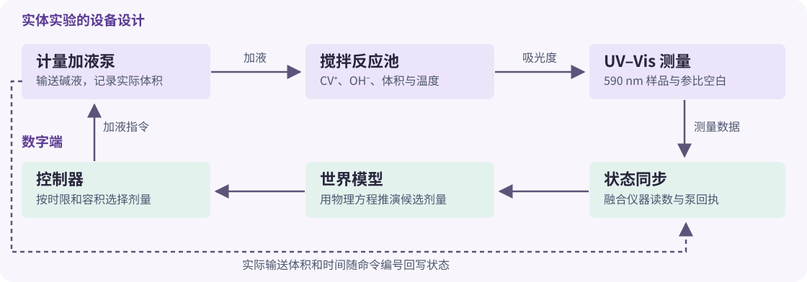
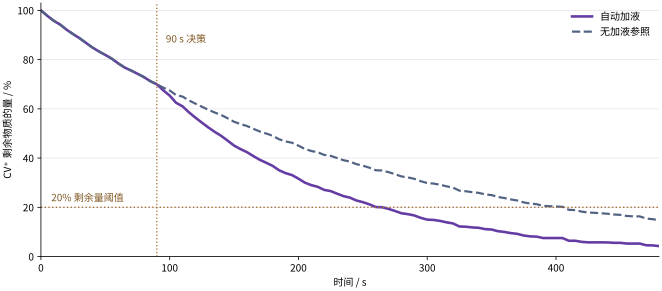

# 第 18 章　世界模型与化学数字孪生

**G18 课程共建 · 2026–2027 学年**

**案例**　用物料衡算和 UV–Vis 测量驱动结晶紫褪色的自动加液实验。

<a href="./assets/labs/g18/index.html" target="_blank" rel="noopener">运行离线实验</a> · <a href="#/code/ch18_uvvis/data/README">数据字典</a> · <a href="#/resources/annual/2026-2027/questions/README?id=ch18">G18 传承题</a>

## 1　90 s 时，泵应该加多少液？

一批结晶紫溶液已经在碱性条件下反应了 90 s。希望在 290 s 前确认结晶紫只剩初始物质的量的 20%，同时尽量少加碱。此时仪器提供 590 nm 的样品和空白吸光度。系统还掌握配液记录和反应池体积。决策要回答两个问题。现在还有多少结晶紫？如果泵加不同体积的液体，未来多久会达到目标？

结晶紫阳离子在碱性条件下逐渐褪色，实验文献用约 590 nm 的吸光度追踪其消耗 [1]。这为物理建模提供了可测的观测量。一次加液同时改变 OH⁻ 的物质的量和反应池体积，后者会稀释结晶紫。**因此终点用结晶紫剩余物质的量判定，仪器仍然测吸光度。** 这两个量之间的转换是本案例的分析化学环节。

## 2　世界模型与自动化实验怎样配合

| 概念 | 在本案例中承担的任务 |
|---|---|
| 世界模型 | 表示结晶紫、OH⁻、液体体积与观测的物理关系。从当前状态向前推演不同加液操作，预测未来的浓度和吸光度。模型结构受守恒与动力学约束，光学增益和速率参数由校准数据估计。 |
| 化学数字孪生 | 将模型对应到一台具体的反应池、泵与 UV–Vis 仪器。随实验读数和泵回执更新状态，再把经过约束检查的动作交给设备执行 [3,4]。 |
| 自动化实验 | 在测量、估计、规划、下发、确认和复测之间运行闭环。当前交付用虚拟仪器与虚拟泵演示闭环，实物连接与验证按后文设计开展。 |

文献中的世界模型也可使用学习到的高维状态表征。V-JEPA 2-AC 利用视频和机器人交互学习动作条件预测，并在真实机械臂上验证抓取与放置规划 [5]。这里的状态和动作可以直接写成化学与仪器的物理量，便于检验模型怎样响应干预。

## 3　用哪些物理量描述反应池

实际系统设计采用一个带光路的搅拌反应池、一台计量加液泵和一套 590 nm UV–Vis 测量单元。样品与参比空白以同一时钟记录。数字端保存初始装液量、碱液浓度、样品批次及校准信息。物理模型由状态转移和观测两部分组成。

| 类别 | 量 | 来源 |
|---|---|---|
| 样品状态 | $n_{\mathrm{CV}}, n_{\mathrm{OH}}$ | CV⁺ 由净吸光度和体积估计，OH⁻ 根据初始量、加液回执及反应计量更新 |
| 设备状态 | $V$、泵状态、命令编号 | 起始装液记录及泵实际输送回执 |
| 操作 | 90 s 时的加液体积 $\Delta V$ | 由模型比较方案，由控制器下发 |
| 观测 | 样品读数 $y$、同刻空白 $z$ | 590 nm 测量单元，单位标记为 A |
| 环境 | 温度 $T$ | 本仿真固定在 294 K。实物应记录温度并检查温度效应 |

### 3.1　反应与物料衡算

把结晶紫的碱性褪色表示为 $\mathrm{CV^+}+\mathrm{OH^-}\rightarrow\mathrm{CV{-}OH}$。两次操作之间，体积固定。假定在所考察范围内，消耗速率对 CV⁺ 和 OH⁻ 各为一级。文献中的过量碱实验提供拟一级条件的参照 [1]。用 L、mol 和 s 为基本单位，批式池中的方程为

$$
\frac{\mathrm d n_{\mathrm{CV}}}{\mathrm dt}
=\frac{\mathrm d n_{\mathrm{OH}}}{\mathrm dt}
=-k_2\frac{n_{\mathrm{CV}}n_{\mathrm{OH}}}{V}.
$$

因此反应消耗的两种反应物物质的量相同。两次加液之间 $n_{\mathrm{OH}}-n_{\mathrm{CV}}$ 保持恒定。碱过量时可近似用 $k'=k_2[\mathrm{OH^-}]$ 描述每一段的拟一级过程。程序同时更新两种物质的量，保留有限体积与化学计量。

一次加液完成后，以实际计量的 $\Delta V$ 更新状态。设储液中 OH⁻ 浓度为 $C_s$，瞬时混合近似下有

$$
V^+=V^-+\Delta V,\qquad
n_{\mathrm{OH}}^+=n_{\mathrm{OH}}^-+C_s\Delta V,\qquad
n_{\mathrm{CV}}^+=n_{\mathrm{CV}}^-.
$$

这个模型把加液视作短于采样时间的操作。真实设备上应测定泵持续时间和混合滞后。若滞后与采样间隔相当，需记录流量随时间的变化，并增加混合状态。

### 3.2　从物质的量推算仪器读数

以 $g=\varepsilon_{590}\ell$ 表示光学增益。Beer–Lambert 定律给出均匀、线性响应范围内理想吸光度与浓度的关系 [2]。

$$
y_t=g\,\frac{n_{\mathrm{CV},t}}{V_t}+b_t+\eta_t,\qquad
z_t=b_t+\xi_t.
$$

$b_t$ 是两路共同基线，$\eta_t,\xi_t$ 表示噪声。$y_t-z_t$ 给出净吸光度。一次加液使 $n_{\mathrm{CV}}$ 暂时连续，$V$ 增大，所以理想净吸光度立即按 $V^-/V^+$ 下降。随后反应才进一步降低 $n_{\mathrm{CV}}$。如果将“吸光度降到初值的 20%”直接当成“剩余量 20%”，稀释就会使终点判断提前。

## 4　校准、同步和自动决策

仿真初始体积为 3.00 mL，CV⁺ 为 10.0 µmol·L⁻¹，OH⁻ 为 10.0 mmol·L⁻¹。虚拟加液储液的 OH⁻ 浓度为 0.100 mol·L⁻¹。反应池体积上限设为 3.60 mL。上述参数、传感器噪声和泵输送偏差都是教学仿真设定。

- **光学校准**　以 0–10 µmol·L⁻¹ 的 6 个 CV⁺ 水平、每个水平 3 次的合成标准拟合 $g$。得到 $\hat g=7.9829\times10^4$ L·mol⁻¹。
- **动力学校准**　用初始 OH⁻ 为 8、12、16、20、25 mM 的 5 条独立合成轨迹拟合 $k_2$，得到 $\hat k_2=0.39785$ L·mol⁻¹·s⁻¹。案例的加液运行另用独立仿真轨迹。
- **状态同步**　每隔 5 s 用 $n_{\mathrm{obs}}=V(y-z)/\hat g$ 更新样品估计。程序融合 35% 模型预测和 65% 光学估计，并施加物质的量非负、两次加液之间 CV⁺ 不增的约束。OH⁻ 的估计由投料账和反应计量更新。
- **方案筛选**　以 90 s 的最新状态为起点，逐一推演 0–0.60 mL 的 7 个候选量。用 94% 的拟合速率和 98% 的指令体积计算较慢情景，再预留 10 s 用于连续两次采样确认。选择满足时限与体积上限的最小剂量。这两个比例是仿真裕量，实物系统应根据校准误差和泵计量确定。
- **执行反馈**　泵收到带编号的指令后返回实际输送体积。数字端按回执时间和实际体积更新投料账，继续采集读数。回执丢失时，将加液后的体积标为待核对，暂停控制和终点判断。

| 自动实验环节 | 建议记录的字段 |
|---|---|
| 采集 | 批次、仪器编号、时间戳、样品、空白、温度、校准版本 |
| 推演 | 决策时刻、估计状态、模型版本、候选剂量、预测时刻和约束 |
| 执行 | 命令编号、计划体积、设备状态、实际输送量和时间戳 |
| 反馈 | 更新后的体积和浓度、连续两次达标的采样点、异常原因 |

## 5　默认仿真结果

<section class="interactive-lab" data-lab="ch18-uvvis-world-model"></section>

在 290 s 截止条件下，0.20 mL 在较慢预测中不能留出足够的确认时间。控制器选择 **0.30 mL**，泵模拟回执为 **0.294 mL**。这次运行的终点以两次连续有效估计均不高于 20% 为判据。

| 结果 | 默认值 |
|---|---:|
| 指令加液量 | 0.300 mL |
| 模拟回执体积 | 0.294 mL |
| 回写的池内体积 | 3.294 mL |
| 混合后 OH⁻ 的估计值 | 18.03 mM |
| 加液前后瞬时 CV⁺ 的物质的量 | 约 21.00 nmol，保持连续 |
| 理想净吸光度瞬时变化 | 0.5587 降至 0.5088 A |
| 自动加液的达标确认时刻 | 275 s |
| 同条件无加液参照的确认时刻 | 415 s |

切换到净吸光度曲线，可以看到稀释贡献。切回剩余量曲线，可以看到加液时物质的量连续，之后反应更快。将剂量上限降到 0.20 mL，会得到“当前约束下无可行方案”。将故障改为决策时空白缺失，会暂停本次加液。将故障改为回执丢失，程序会停在体积待核对状态，不能用指令体积替代已确认输送体积。

## 6　怎样把原型接到真实自动化实验

先用同一台仪器的稳定标准核查光学线性和同步空白，再在多个 OH⁻ 水平、多个独立批次中拟合与验证反应模型。每次加液需要独立计量，并记录混合所需时间。留出整条未参与校准的加液实验，从加液前的测量预测加液后的净吸光度和终点。可比较曲线 RMSE、终点时间误差、相同剂量的重复性以及泵回执与独立计量的一致性。

对实体接入，可先把记录导入数字端回放，再让数字端跟随仪器在线更新并只输出候选方案。实测验证完成后，再由经审定的设备接口处理指令、容积边界、设备状态和回执。命令与回执用编号关联。执行结果待核对时保留日志并暂停后续动作，避免重复加液。当前交付已经实现仿真中的测量、决策、执行与反馈。真实对象的同步、性能和控制效果仍需实验验证。

从单次加液可扩展到多次滚动决策。模型预测控制用预测状态比较下一步动作，主动学习可选择最能减小参数不确定性的实验，贝叶斯优化可以探索不同批次的配液条件。Zhao 与 Zeng 的研究评述讨论了在虚拟环境中检验自动化实验流程的用途 [9]。化学自动化中的实际参照包括 MATTERIX 的机器人实验室孪生框架 [6]、化工模型与实验数据的知识图谱组织 [7]，以及过程分析技术与模型预测控制联通的生物制造测试平台 [8]。

## 7　课堂演示与复现

1. 打开 <a href="./assets/labs/g18/index.html" target="_blank" rel="noopener">运行离线实验</a>，以默认时限运行一次，查看候选剂量和泵回执。
2. 先看剩余量，再切到净吸光度，解释加液前后的观测变化。
3. 降低剂量上限或切换泵回执丢失，解释为什么流程进入监测或暂停状态。
4. 在项目目录运行 \`node code/ch18_uvvis/reproduce.cjs\`，重建校准、决策、时序和事件 CSV。修改模型后运行 \`node code/ch18_uvvis/build-lab.cjs\` 重新嵌入 HTML。

## 参考文献

1. Sola Larrañaga, C. et al. [Active Learning of Physical Chemistry Principles through the One-Molecule Approach: Crystal Violet for Spectroscopy, Kinetics, and Protein Binding](https://doi.org/10.1021/acs.jchemed.6c00184). *J. Chem. Educ.* **103**, 5076–5084 (2026).
2. IUPAC. [Beer–Lambert Law](https://doi.org/10.1351/goldbook.B00626). *Compendium of Chemical Terminology*, 5th ed. (2025).
3. Kritzinger, W. et al. [Digital Twin in Manufacturing: A Categorical Literature Review and Classification](https://doi.org/10.1016/j.ifacol.2018.08.474). *IFAC-PapersOnLine* **51**, 1016–1022 (2018).
4. ISO. [ISO 23247-1:2021. Digital Twin Framework for Manufacturing, Part 1](https://www.iso.org/standard/75066.html) (2021).
5. Assran, M. et al. [V-JEPA 2: Self-Supervised Video Models Enable Understanding, Prediction and Planning](https://arxiv.org/abs/2506.09985). arXiv:2506.09985 (2025, 预印本).
6. Darvish, K. et al. [MATTERIX: Toward a Digital Twin for Robotics-Assisted Chemistry Laboratory Automation](https://doi.org/10.1038/s43588-025-00924-4). *Nat. Comput. Sci.* **6**, 67–82 (2026).
7. Zhang, S.; Zhang, J.; Lapkin, A. A. [A Knowledge Graph Framework for Digital Twins of Chemical Processes](https://doi.org/10.1038/s44286-026-00392-1). *Nat. Chem. Eng.* **3**, 286–297 (2026).
8. Satwekar, A. et al. [Operationalizing Digital Twins in Biomanufacturing through Interoperable Process Analytical Technology](https://doi.org/10.1007/s00449-026-03369-9). *Bioprocess Biosyst. Eng.* **49** (2026).
9. Zhao, T.; Zeng, Y. [Digital Twins for Self-Driving Chemistry Laboratories](https://doi.org/10.1038/s43588-025-00908-4). *Nat. Comput. Sci.* **6**, 15–16 (2026，2025 年在线发表，研究评述).
